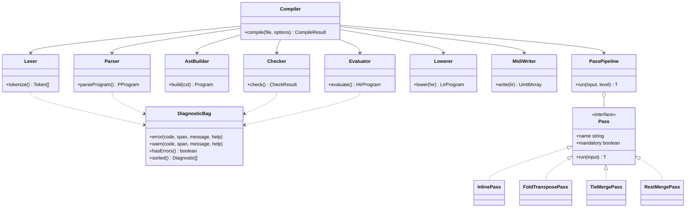

## 개요

이 문서는 Clef 컴파일러를 TypeScript로 짓기 위한 구현 설계도이다. 스펙(음악 프로그래밍 언어 컴파일러 설계서)이 언어와 각 단계의 입출력을 정한다면, 이 문서는 그것을 어떤 프로젝트 설정, 폴더, 클래스, 함수로 구현하는지를 정한다. 두 문서가 어긋나면 스펙이 우선이다.

문서 안의 코드는 임시 프로젝트에서 직접 타입 검사를 통과시키고, 스펙의 입출력 예시로 실행해 확인한 것이다. 확인한 범위는 다음과 같다.

| 확인한 것                    | 방법                                                                                            |
| ---------------------------- | ----------------------------------------------------------------------------------------------- |
| 모든 파일의 타입 검사        | `strict`, `noUncheckedIndexedAccess`, `exactOptionalPropertyTypes` 상태에서 `tsc` 통과          |
| 토큰 출력                    | 스펙 렉서 예시 5개와 오류 3개(E001 ~ E003)                                                      |
| 오류와 경고의 줄:열과 메시지 | 스펙 테스트 명세의 E101 ~ E403, W601 ~ W603 전부                                                |
| 평가에서 틱 변환까지의 출력  | 프로그램 P, 묶음, 병렬, 쉼표, 반복, 두 트랙, 함수, 반음 이조, 장조와 단조의 온음계 이조, 붙임줄 |
| 최적화 전후 동일성           | 정상 프로그램 10개와 E307 프로그램 4개에서 `-O0`과 기본 옵션의 LIR과 진단이 같음                |
| MIDI 파일                    | `mido`로 읽어 형식, 분해능, 템포, 박자표, 음 이벤트 확인                                        |
| 파헬벨 카논 예제             | 4트랙으로 컴파일되고 약 43.6초 길이의 `.mid`가 나옴                                             |

문서에 싣지 않은 코드(렉서와 파서의 문장 처리, 검사기의 세부 등)도 같은 임시 프로젝트에 구현되어 위 확인에 쓰였다. 이 문서는 구조와 핵심 알고리즘을 코드로 싣고, 나머지는 시그니처와 규칙으로 적는다. 직접 구현한 결과를 비교하고 싶으면 참조 구현을 따로 줄 수 있다.

구성은 다음과 같다.

- 프로젝트 설정과 폴더 구조
- 객체 지향 설계와 모듈 의존 방향
- 모듈별 구현(자료구조, 알고리즘, 주의점)
- 진단 위치 규칙과 테스트 설계
- CLI, 시연, 구현 순서
- 스펙에 없어서 이 문서가 정한 가정과, 확인하지 못한 항목

## 프로젝트 설정

### 도구 구성

개발 도구는 Vite+(명령어 `vp`) 하나로 통일한다. Vite+는 Vite, Vitest, Oxlint, Oxfmt, Rolldown을 한 CLI로 묶은 도구이고 설정을 `vite.config.ts` 한 파일에 둔다. 알파 단계이므로 명령과 설정 키는 `vp help`로 다시 확인한다.

| 용도                          | 도구                     | 호출                 |
| ----------------------------- | ------------------------ | -------------------- |
| 개발 서버(시연 앱)            | Vite                     | `vp dev`             |
| 빌드                          | Rolldown                 | `vp build`           |
| 테스트                        | Vitest                   | `vp test`            |
| 린트                          | Oxlint                   | `vp lint`            |
| 포맷                          | Oxfmt                    | `vp fmt`             |
| 린트, 포맷, 타입 검사 한 번에 | Oxlint, Oxfmt, 타입 검사 | `vp check`           |
| CLI 실행(개발 중)             | vpx                      | `vp run clef <파일>` |

Vitest, Oxlint, Oxfmt는 Vite+가 감싸므로 직접 설치하지 않고 `vp test`, `vp lint`, `vp fmt`로만 호출한다. Node.js는 20.19 이상 또는 22.12 이상이 필요하다.

CLI는 `vpx`로 실행한다. `package.json`의 `clef` 스크립트가 `vpx src/cli/main.ts`이므로 `vp run clef examples/canon.clef`처럼 쓴다. `vpx`는 Vite+에 들어 있는 oxc-node 로더로 TypeScript를 바로 실행하므로 `tsx`를 따로 설치하지 않는다. 코드가 생성자 매개변수 속성(`constructor(private readonly x)`)을 쓰는데, Node의 타입 제거 실행은 이 문법을 처리하지 못하지만 `vpx`는 처리한다. 같은 이유로 `vp create`가 켜 둔 `erasableSyntaxOnly`는 끈다.

### 명령

프로젝트는 `vite:application` 템플릿으로 만든다. 브라우저 시연 앱(`index.html`)이 있고 CLI도 같은 패키지에 두므로 이 템플릿이 맞다. `vite:monorepo`는 패키지를 여러 개로 나눌 때, `vite:library`는 npm 배포용이라 쓰지 않는다. 템플릿 이름은 `vp create --list`로 확인한다.

```bash
cd clef                                    # 클론해 둔 폴더 (.git이 이미 있음)
vp create vite:application --directory . --package-manager pnpm
vp install
vp add -D fast-check @types/node   # fast-check는 속성 테스트용
vp run clef examples/canon.clef    # CLI (vpx src/cli/main.ts)
vp dev               # 브라우저 시연 앱
vp test              # 단위, 골든, 속성 테스트
vp check             # 린트 + 포맷 + 타입 검사. 커밋 전에 통과시킨다
```

폴더에 `.git`이 있으면 비어 있지 않은 폴더로 취급되어 템플릿에 따라 중단될 수 있다. `--force`는 `vp create` 문서에 적혀 있지 않으므로 기대하지 않는다. 중단되면 임시 폴더에 `--no-git`으로 만든 뒤 파일을 옮긴다.

```bash
cd ..
vp create vite:application --directory clef-tmp --no-git --package-manager pnpm
mv clef-tmp/* clef-tmp/.[!.]* clef/ && rmdir clef-tmp
cd clef && vp install
```

패키지 매니저는 pnpm을 쓴다. `--package-manager`는 `pnpm`, `npm`, `yarn`, `bun` 중에서 고를 수 있지만, 실행 환경이 Node(Vitest, vpx)이므로 설치 환경도 Node 계열로 맞춘다. 팀원 모두 같은 매니저를 쓴다.

### 설정 파일

`vite.config.ts`는 Vite+가 읽는 유일한 설정이다. 테스트 위치, 린트 제외 경로, 포맷 옵션만 둔다.

```ts
import { defineConfig } from 'vite-plus';

export default defineConfig({
  test: { include: ['tests/**/*.test.ts'] },
  lint: { ignorePatterns: ['dist/**'] },
  fmt: { semi: true, singleQuote: true },
});
```

`tsconfig.json`은 `vp create`가 만든 파일을 바탕으로 아래 항목만 보장하면 된다. 문서의 코드는 이 설정에서 일반 `tsc`로 타입 검사를 통과했다. Vite+ 1.7.0부터 `vp check`의 타입 검사는 TypeScript 7 컴파일러의 Rust 포팅(tsrs) 위에서 돌아가므로, 아래 옵션을 켠 상태에서 `vp check`도 통과하는지 처음에 한 번 확인한다.

| 옵션                         | 값          | 이유                                                                                    |
| ---------------------------- | ----------- | --------------------------------------------------------------------------------------- |
| `strict`                     | true        | 기본 안전망                                                                             |
| `noUncheckedIndexedAccess`   | true        | `tokens[i]`가 `undefined`일 수 있음을 타입에 반영한다. 렉서와 파서의 범위 오류를 막는다 |
| `exactOptionalPropertyTypes` | true        | 선택 필드에 `undefined`를 몰래 넣는 일을 막는다                                         |
| `noImplicitOverride`         | true        | 상속 사용 시 실수 방지                                                                  |
| `verbatimModuleSyntax`       | true        | 타입만 가져올 때 `import type`을 강제한다                                               |
| `allowImportingTsExtensions` | true        | import 경로에 `.ts`를 쓴다                                                              |
| `target`                     | ES2022 이상 | `BigInt` 리터럴(`0n`) 사용                                                              |
| `moduleResolution`           | Bundler     | Vite와 같은 해석 규칙                                                                   |
| `erasableSyntaxOnly`         | false       | 생성자 매개변수 속성을 쓴다. `vpx`와 Vite는 이 문법을 처리한다                          |

### 의존성 정책

배포하지 않는 수업 과제이므로 의존성의 크기는 따지지 않고, 코드를 빨리 짤 수 있는지를 기준으로 고른다. 단, 렉서와 파서는 평가 항목(각 10점)이므로 파서 생성기나 렉서 생성기를 쓰지 않는다.

아래 라이브러리는 모두 처음부터 설치해 둔다.

| 라이브러리                       | 쓰는 단계 | 쓰는 곳                                                                                                                                                                                   |
| -------------------------------- | --------- | ----------------------------------------------------------------------------------------------------------------------------------------------------------------------------------------- |
| `ts-pattern`                     | 5단계부터 | 두 값의 짝을 보는 분기. 검사기의 연산자 타입 규칙(`match([l, r]).with(['Note', 'Interval'], …).exhaustive()`)처럼 표를 그대로 옮길 때 쓴다. `kind` 하나만 보는 분기는 `switch`로 충분하다 |
| `es-toolkit`                     | 전체      | `groupBy`(붙임줄 검사의 `byStart`), `uniqBy`(진단 중복 제거), `sortBy`, `sumBy`, `range` 같은 컬렉션 도우미                                                                               |
| `picocolors`                     | 9단계     | CLI 진단 출력의 색                                                                                                                                                                        |
| `@tonejs/midi`                   | 10단계    | Vitest 안에서 `.mid`를 읽어 검증한다. SMF 기록기를 직접 짜지 않고 이것으로 대신해도 된다(채점 대상이 아니다)                                                                              |
| `codemirror`, `@codemirror/lint` | 11단계    | 웹 시연의 입력창. lint 확장으로 진단 위치에 밑줄을 긋는다                                                                                                                                 |
| `tone`                           | 11단계    | 웹 시연의 재생                                                                                                                                                                            |

개발 의존성은 `fast-check`, `@types/node`와 Vite+이다. `tone`과 `codemirror`는 DOM이 필요하므로 `src/web`에서만 쓴다. `src/core`에서 쓰면 CLI가 같은 코드를 쓰지 못한다.

쓰지 않기로 한 것도 적어 둔다. `zod`는 검증할 구조화된 외부 입력이 없어서 쓰지 않는다. 입력은 `.clef` 텍스트뿐이고 그 검증이 곧 파서의 일이다. CLI 인수 파싱 라이브러리는 옵션이 세 개뿐이라 `node:util`의 `parseArgs`로 충분하다.

## 폴더 구조

### 트리

```text
clef/
├─ index.html                     시연 앱 진입점 (Vite 규칙: 프로젝트 루트)
├─ vite.config.ts
├─ tsconfig.json
├─ package.json
├─ examples/
│  ├─ program-p.clef              스펙 전체에서 쓰는 공통 프로그램 P
│  └─ canon.clef                  파헬벨 카논 (시연용)
├─ src/
│  ├─ core/                       컴파일러 본체. DOM과 파일 시스템에 의존하지 않는다
│  │  ├─ common/
│  │  │  ├─ span.ts               Span, SourceFile
│  │  │  ├─ rational.ts           Rational (BigInt 분수)
│  │  │  └─ assert-never.ts       assertNever
│  │  ├─ diagnostics/
│  │  │  └─ diagnostic.ts         Diagnostic, DiagCode, DiagnosticBag, formatShort, formatFull
│  │  ├─ music/
│  │  │  ├─ pitch.ts              MIDI 번호, 음계, diatonicShift
│  │  │  └─ instruments.ts        악기표, 채널 배정
│  │  ├─ lexer/
│  │  │  ├─ token.ts              Token, KEYWORDS, formatToken
│  │  │  └─ lexer.ts              Lexer
│  │  ├─ parser/
│  │  │  ├─ cst.ts                구문 트리 타입
│  │  │  └─ parser.ts             Parser
│  │  ├─ ast/
│  │  │  ├─ ast.ts                AST 타입, mapChildren
│  │  │  └─ builder.ts            AstBuilder (구문 트리에서 AST)
│  │  ├─ check/
│  │  │  └─ checker.ts            Checker (헤더, 이름, 타입, 재귀, 경고)
│  │  ├─ eval/
│  │  │  ├─ hir.ts                HIR 타입, compareEvents
│  │  │  ├─ ties.ts               resolveTies, nextNoteAfter
│  │  │  └─ evaluator.ts          Evaluator (AST에서 HIR)
│  │  ├─ opt/
│  │  │  ├─ pass.ts               Pass, PassPipeline
│  │  │  ├─ ast/inline.ts         InlinePass
│  │  │  ├─ ast/fold-transpose.ts FoldTransposePass
│  │  │  └─ hir/passes.ts         TieMergePass, RestMergePass
│  │  ├─ lower/
│  │  │  └─ lowerer.ts            Lowerer, LIR 타입, formatLir
│  │  ├─ smf/
│  │  │  └─ writer.ts             MidiWriter
│  │  ├─ emit/                    --emit 단계별 텍스트 출력기
│  │  │  ├─ tokens.ts  cst.ts  ast.ts  typed.ts  hir.ts  lir.ts
│  │  ├─ pipeline.ts              Compiler (퍼사드)
│  │  └─ index.ts                 공개 API: Compiler, SourceFile, 타입들
│  ├─ cli/
│  │  └─ main.ts                  clef <파일> [--emit 단계] [-O0] [-o 출력.mid]
│  └─ web/
│     ├─ main.ts                  입력창, 단계 탭, 진단 표시
│     └─ player.ts                LIR을 틱에서 초로 바꿔 재생
└─ tests/
   ├─ unit/                       rational, pitch, ties, smf 같은 순수 함수
   ├─ golden/
   │  ├─ golden.test.ts           골든 러너
   │  ├─ lexer/  parser/  ast/  check/  eval/  opt/  ir/
   │                             각 폴더에 이름.clef 와 이름.expected 쌍
   └─ property/                   fast-check 속성 테스트
```

### 파일별 책임

| 파일                        | 책임                                                   | 의존하는 것                      |
| --------------------------- | ------------------------------------------------------ | -------------------------------- |
| `common/span.ts`            | 소스 위치와 소스 줄 조회                               | 없음                             |
| `common/rational.ts`        | 정확한 분수, 틱 변환                                   | 없음                             |
| `diagnostics/diagnostic.ts` | 진단 수집, 정렬, 중복 제거, 출력 형식                  | `common`                         |
| `music/pitch.ts`            | MIDI 번호, 이름, 음계, 온음계 이조                     | 없음                             |
| `music/instruments.ts`      | 악기 이름, GM 번호, 음역, 채널 배정                    | 없음                             |
| `lexer/*`                   | 문자열에서 토큰 배열                                   | `common`, `diagnostics`, `music` |
| `parser/*`                  | 토큰에서 구문 트리, 문장 단위 오류 복구                | `lexer`, `diagnostics`           |
| `ast/*`                     | 구문 트리에서 AST, AST 공통 변환 도구                  | `parser`, `common`               |
| `check/checker.ts`          | 이름 해석, 타입 검사, 재귀 검출, 경고, 헤더 확정       | `ast`, `music`                   |
| `eval/*`                    | AST를 평가해 HIR(유리수 시간) 생성, 길이와 붙임줄 검사 | `ast`, `check`, `music`          |
| `opt/*`                     | AST 최적화와 HIR 최적화                                | `ast`, `eval`                    |
| `lower/lowerer.ts`          | HIR를 정수 틱의 LIR로 변환                             | `eval`                           |
| `smf/writer.ts`             | LIR을 표준 MIDI 파일 바이트로 변환                     | `lower`, `music`                 |
| `emit/*`                    | 각 단계 산출물을 골든 파일과 같은 텍스트로 출력        | 각 단계 타입                     |
| `pipeline.ts`               | 단계 호출 순서, 오류 시 중단, 산출물 모음              | 전부                             |

## 객체 지향 설계

### 설계 원칙

1. **데이터는 불변의 합 타입으로, 행동은 클래스나 함수로 둔다.** Token, CST, AST, HIR, LIR은 판별 유니온(`kind` 필드)이고 모든 필드가 `readonly`이다. 노드마다 클래스를 만들고 `accept(visitor)`를 두는 방식은 쓰지 않는다. TypeScript에서는 `switch (e.kind)`가 모든 경우를 다루지 않으면 컴파일 오류가 나므로 방문자 패턴과 같은 안전성을 더 적은 코드로 얻는다.
2. **한 단계는 한 클래스이다.** `Lexer`, `Parser`, `AstBuilder`, `Checker`, `Evaluator`, `Lowerer`, `MidiWriter`는 생성자로 입력과 `DiagnosticBag`을 받고, 공개 메서드 하나(`tokenize`, `parseProgram`, `build`, `check`, `evaluate`, `lower`, `write`)로 결과를 돌려준다. 진행 상태(위치, 심볼 표, 호출 그래프)는 `private` 필드로 가둔다. 한 인스턴스는 한 번만 실행한다.
3. **오류는 값으로 모으고, 예외는 문장 단위 복구에만 쓴다.** 사용자 소스의 오류는 `DiagnosticBag`에 쌓는다. 파서의 `ParseAbort`, 평가기의 `EvalAbort`는 "이 문장은 포기하고 다음 문장으로 간다"를 구현하는 내부 예외이며 클래스 밖으로 나가지 않는다. 컴파일러 자신의 버그는 일반 `Error`로 던져 조용히 넘어가지 않게 한다.
4. **최적화는 `Pass<T>` 인터페이스를 구현하는 작은 클래스로 만든다.** `PassPipeline<T>`가 목록을 순서대로 돌린다. `mandatory`인 단계는 `-O0`에서도 실행한다. 새 최적화는 클래스 하나와 목록에 한 줄 추가이다.
5. **순수 함수 모듈을 따로 둔다.** `Rational`, `diatonicShift`, `resolveTies`, `formatLength`는 상태가 없는 함수나 불변 클래스라서 단위 테스트가 가장 쉽고 가장 먼저 만든다.
6. **`Compiler`는 퍼사드이다.** CLI와 웹은 `Compiler.compile(file, options)`만 호출하고 각 단계 클래스를 직접 쓰지 않는다.

### 클래스 구성



단계 흐름은 다음과 같다. 실선은 정상 흐름이고, 어느 단계든 오류가 있으면 그 단계 산출물까지 담아 `CompileResult`를 돌려주고 멈춘다.


### 의존 방향

화살표 방향으로만 import한다. 반대 방향 import가 필요해 보이면 공통 타입을 아래 계층으로 내린다.

```text
common  <-  diagnostics
common  <-  music
music, diagnostics  <-  lexer  <-  parser  <-  ast  <-  check  <-  eval  <-  opt  (AST 최적화는 ast, HIR 최적화는 eval을 본다)
eval  <-  lower  <-  smf
emit  <-  위 모든 타입 (읽기만 한다)
pipeline  <-  위 전부
cli, web  <-  pipeline 과 emit 만
```

규칙 두 가지를 어기지 않는다. 첫째, `core` 안에서 `node:` 모듈과 DOM을 쓰지 않는다. 그래야 CLI와 브라우저가 같은 코드를 쓴다. 둘째, 한 단계는 이전 단계의 산출물 타입만 알고 그 단계의 클래스는 모른다.

## 모듈별 구현

### 공통 계층

`Span`은 한 줄 안의 구간이고 줄과 열을 1부터 센다. `SourceFile`은 진단 출력에서 해당 소스 줄을 꺼내는 데 쓴다.

`src/core/common/span.ts`

```ts
/** 소스 안의 한 구간. 줄과 열은 모두 1부터 센다. 한 토큰은 한 줄 안에 있다. */
export interface Span {
  readonly line: number;
  readonly col: number;
  readonly endCol: number;
}

export function span(line: number, col: number, endCol: number): Span {
  return { line, col, endCol };
}

/** 소스 전체와 줄별 접근을 담당한다. 진단 출력에서 해당 줄을 꺼낼 때 쓴다. */
export class SourceFile {
  private readonly lines: readonly string[];

  constructor(
    readonly name: string,
    readonly text: string,
  ) {
    this.lines = text.split('\n');
  }

  lineText(line: number): string {
    return (this.lines[line - 1] ?? '').replace(/\r$/, '');
  }

  get lineCount(): number {
    return this.lines.length;
  }
}
```

`Rational`은 기약 분수로 정규화된 불변 객체이다. 시간 단위는 온음표를 1로 둔다. 틱 변환은 `toTicks(1920n)`이 정수가 아니면 `null`을 돌려주는 방식이고, `null`이 E302의 근거가 된다.

`src/core/common/rational.ts`

```ts
const gcd = (a: bigint, b: bigint): bigint => {
  let x = a < 0n ? -a : a;
  let y = b < 0n ? -b : b;
  while (y !== 0n) {
    [x, y] = [y, x % y];
  }
  return x;
};

/**
 * 기약 분수로 정규화된 불변 유리수. 분모는 항상 양수다.
 * 시간 단위는 온음표 = 1이다.
 */
export class Rational {
  static readonly ZERO = new Rational(0n, 1n);
  static readonly ONE = new Rational(1n, 1n);

  private constructor(
    readonly num: bigint,
    readonly den: bigint,
  ) {}

  static of(num: bigint | number, den: bigint | number = 1n): Rational {
    let n = BigInt(num);
    let d = BigInt(den);
    if (d === 0n) throw new RangeError('zero denominator');
    if (d < 0n) {
      n = -n;
      d = -d;
    }
    const g = gcd(n, d);
    return new Rational(n / g, d / g);
  }

  add(o: Rational): Rational {
    return Rational.of(this.num * o.den + o.num * this.den, this.den * o.den);
  }
  sub(o: Rational): Rational {
    return Rational.of(this.num * o.den - o.num * this.den, this.den * o.den);
  }
  mul(o: Rational): Rational {
    return Rational.of(this.num * o.num, this.den * o.den);
  }
  div(o: Rational): Rational {
    return Rational.of(this.num * o.den, this.den * o.num);
  }

  /** 음수, 0, 양수를 돌려준다. */
  cmp(o: Rational): number {
    const l = this.num * o.den;
    const r = o.num * this.den;
    return l < r ? -1 : l > r ? 1 : 0;
  }
  equals(o: Rational): boolean {
    return this.num === o.num && this.den === o.den;
  }
  isZero(): boolean {
    return this.num === 0n;
  }
  isInteger(): boolean {
    return this.den === 1n;
  }

  /** 온음표당 틱 수를 곱해 정수가 되면 그 값을, 아니면 null을 돌려준다. */
  toTicks(ticksPerWhole: bigint): bigint | null {
    const scaled = this.num * ticksPerWhole;
    return scaled % this.den === 0n ? scaled / this.den : null;
  }

  toString(): string {
    return this.den === 1n ? this.num.toString() : `${this.num}/${this.den}`;
  }
}

export function maxRational(a: Rational, b: Rational): Rational {
  return a.cmp(b) >= 0 ? a : b;
}
```

`assert-never.ts`는 `switch`의 완전성을 문장 위치에서 강제할 때 쓴다. 값을 돌려주는 함수에서는 반환 타입 검사가 같은 역할을 하므로 필요하지 않다.

```ts
export function assertNever(x: never): never {
  throw new Error(`unreachable: ${JSON.stringify(x)}`);
}
```

### 진단

진단은 `DiagnosticBag` 하나에 모은다. 출력 전에 `sorted()`를 거치며, 같은 코드와 위치와 메시지는 하나로 합치고 (줄, 열, 코드) 순으로 정렬하며 오류는 50개까지만 남긴다. 중복 제거가 필요한 이유는 인라이닝 때문이다. 인수 식이 본문에 복제되면 같은 오류가 두 번 나올 수 있고, `-O0`과 같은 출력을 내려면 합쳐야 한다.

`formatShort`는 골든 테스트가 쓰는 `줄:열 종류[코드]: 메시지` 형식이고 `help`는 5칸 들여 쓴다. `formatFull`은 CLI가 쓰는 소스 줄과 밑줄이 있는 형식이다.

`src/core/diagnostics/diagnostic.ts`

```ts
import type { Span } from '../common/span.ts';
import type { SourceFile } from '../common/span.ts';

export type Severity = 'error' | 'warning';

export type DiagCode =
  | 'E001'
  | 'E002'
  | 'E003'
  | 'E010'
  | 'E011'
  | 'E101'
  | 'E102'
  | 'E103'
  | 'E104'
  | 'E201'
  | 'E203'
  | 'E204'
  | 'E301'
  | 'E302'
  | 'E303'
  | 'E304'
  | 'E305'
  | 'E306'
  | 'E307'
  | 'E401'
  | 'E402'
  | 'E403'
  | 'W601'
  | 'W602'
  | 'W603';

export interface Diagnostic {
  readonly severity: Severity;
  readonly code: DiagCode;
  readonly message: string;
  readonly span: Span;
  readonly help?: string;
}

const MAX_ERRORS = 50;

/** 컴파일 한 번 동안 모든 단계가 공유하는 진단 수집기. */
export class DiagnosticBag {
  private readonly items: Diagnostic[] = [];

  error(code: DiagCode, span: Span, message: string, help?: string): void {
    this.add({ severity: 'error', code, span, message, ...(help ? { help } : {}) });
  }

  warn(code: DiagCode, span: Span, message: string, help?: string): void {
    this.add({ severity: 'warning', code, span, message, ...(help ? { help } : {}) });
  }

  private add(d: Diagnostic): void {
    this.items.push(d);
  }

  hasErrors(): boolean {
    return this.items.some((d) => d.severity === 'error');
  }

  errorCount(): number {
    return this.items.filter((d) => d.severity === 'error').length;
  }

  /** 같은 진단은 하나로 합치고, (줄, 열, 코드) 순으로 정렬하며, 오류는 50개까지만 남긴다. */
  sorted(): Diagnostic[] {
    const seen = new Set<string>();
    const unique = this.items.filter((d) => {
      const key = `${d.code}|${d.span.line}|${d.span.col}|${d.message}`;
      return seen.has(key) ? false : (seen.add(key), true);
    });
    const all = unique.sort(
      (a, b) =>
        a.span.line - b.span.line ||
        a.span.col - b.span.col ||
        (a.code < b.code ? -1 : a.code > b.code ? 1 : 0),
    );
    let errors = 0;
    return all.filter((d) => d.severity === 'warning' || ++errors <= MAX_ERRORS);
  }
}

/** 골든 테스트용 짧은 형식. 예: "1:21 error[E307]: ..." */
export function formatShort(d: Diagnostic): string {
  const head = `${d.span.line}:${d.span.col} ${d.severity}[${d.code}]: ${d.message}`;
  return d.help ? `${head}\n     help: ${d.help}` : head;
}

/** CLI용 전체 형식. 소스 줄과 밑줄을 함께 보여 준다. */
export function formatFull(file: SourceFile, d: Diagnostic): string {
  const { line, col, endCol } = d.span;
  const gutter = String(line);
  const pad = ' '.repeat(gutter.length);
  const underline = ' '.repeat(col - 1) + '^'.repeat(Math.max(1, endCol - col));
  const out = [
    `${file.name}:${line}:${col}: ${d.severity}[${d.code}]: ${d.message}`,
    `${gutter} | ${file.lineText(line)}`,
    `${pad} | ${underline}`,
  ];
  if (d.help) out.push(`${pad} = help: ${d.help}`);
  return out.join('\n');
}
```

### 음악 도메인

MIDI 번호는 `12 * (옥타브 + 1) + 음이름 + 임시표`이다(C4 = 60). 진단 메시지에 쓰는 이름은 항상 올림표로 쓴다(61은 `C#4`).

`diatonicShift`는 스펙의 온음계 이조를 구현한다. 으뜸음 기준 오프셋이 음계에 없으면 `null`을 돌려주고, 호출 쪽이 E307을 보고한다. 음수 계단은 `Math.floor`로 옥타브를 계산해 같은 식으로 처리한다.

`src/core/music/pitch.ts`

```ts
export type Accidental = '' | '#' | 'b';
export type Letter = 'A' | 'B' | 'C' | 'D' | 'E' | 'F' | 'G';
export type Mode = 'major' | 'minor';

const LETTER_PC: Readonly<Record<Letter, number>> = {
  C: 0,
  D: 2,
  E: 4,
  F: 5,
  G: 7,
  A: 9,
  B: 11,
};

const SHARP_NAMES = ['C', 'C#', 'D', 'D#', 'E', 'F', 'F#', 'G', 'G#', 'A', 'A#', 'B'] as const;

/** 음이름과 임시표에서 0 이상 11 이하의 음높이 클래스를 구한다. */
export function pitchClass(letter: Letter, acc: Accidental): number {
  const delta = acc === '#' ? 1 : acc === 'b' ? -1 : 0;
  return (((LETTER_PC[letter] + delta) % 12) + 12) % 12;
}

/** MIDI 번호. C4 = 60. 옥타브 0부터 9까지, 임시표 때문에 범위 밖이 될 수 있어 호출 쪽에서 검사한다. */
export function midiOf(letter: Letter, acc: Accidental, octave: number): number {
  const delta = acc === '#' ? 1 : acc === 'b' ? -1 : 0;
  return 12 * (octave + 1) + LETTER_PC[letter] + delta;
}

/** 진단 메시지용 이름. 항상 올림표로 쓴다. 60 -> "C4". */
export function pitchName(midi: number): string {
  const pc = ((midi % 12) + 12) % 12;
  return `${SHARP_NAMES[pc] ?? '?'}${Math.floor(midi / 12) - 1}`;
}

export const MAJOR_SCALE: readonly number[] = [0, 2, 4, 5, 7, 9, 11];
/** 자연 단음계만 지원한다. */
export const MINOR_SCALE: readonly number[] = [0, 2, 3, 5, 7, 8, 10];

export function scaleOf(mode: Mode): readonly number[] {
  return mode === 'major' ? MAJOR_SCALE : MINOR_SCALE;
}

/**
 * 조성의 음계 위에서 steps계단 이동한다.
 * pitch가 음계 밖의 음이면 null을 돌려주고, 호출 쪽이 E307을 보고한다.
 */
export function diatonicShift(
  pitch: number,
  steps: number,
  tonicPc: number,
  scale: readonly number[],
): number | null {
  const offset = (((pitch - tonicPc) % 12) + 12) % 12;
  const k = scale.indexOf(offset);
  if (k < 0) return null;
  const base = pitch - offset;
  const k2 = k + steps;
  const oct = Math.floor(k2 / 7);
  const deg = k2 - 7 * oct;
  return base + 12 * oct + (scale[deg] as number);
}
```

검증한 값은 다음과 같다.

| 호출                   | 결과          |
| ---------------------- | ------------- |
| C장조, `C4(60) +2d`    | 64 (E4)       |
| C장조, `D4(62) +2d`    | 65 (F4)       |
| A단조, `A4(69) +2d`    | 72            |
| G장조, `B4(71) +2d`    | 74            |
| C장조, `C4 -1d`        | 59            |
| C장조, `C4 +7d`, `-7d` | 72, 48        |
| C장조, `C#4(61) +2d`   | `null` (E307) |

악기표는 초안 값이다. 음역과 GM 번호는 구현하면서 바꿀 수 있고, 한 곳에만 있으므로 수정 범위가 작다. 채널 9(타악기)는 건너뛰어 트랙은 최대 15개이다.

`src/core/music/instruments.ts`

```ts
export interface Instrument {
  readonly name: string;
  /** General MIDI 프로그램 번호, 0부터 시작. */
  readonly program: number;
  /** 연주 가능한 MIDI 음 범위(양 끝 포함). */
  readonly low: number;
  readonly high: number;
}

/** 초안 값이다. 음역과 프로그램 번호는 구현하면서 확정한다. */
export const INSTRUMENTS: readonly Instrument[] = [
  { name: 'piano', program: 0, low: 21, high: 108 },
  { name: 'guitar', program: 24, low: 40, high: 88 },
  { name: 'bass', program: 32, low: 28, high: 67 },
  { name: 'cello', program: 42, low: 36, high: 84 },
  { name: 'violin', program: 40, low: 55, high: 100 },
  { name: 'flute', program: 73, low: 60, high: 96 },
];

const BY_NAME = new Map(INSTRUMENTS.map((i) => [i.name, i]));

export function findInstrument(name: string): Instrument | undefined {
  return BY_NAME.get(name);
}

/** 채널 9는 타악기라 건너뛴다. 15개를 넘으면 undefined. */
export function channelFor(trackIndex: number): number | undefined {
  const channel = trackIndex < 9 ? trackIndex : trackIndex + 1;
  return channel <= 15 ? channel : undefined;
}
```

### 렉서

토큰은 판별 유니온이다. 공통 필드는 `lexeme`, `span`, `spaceBefore`이고 종류에 따라 값 필드가 붙는다. `spaceBefore`는 `f(m1)`(호출)과 `f (m1)`(나열)을 파서가 구분하는 유일한 근거이다.

`src/core/lexer/token.ts`

```ts
import type { Span } from '../common/span.ts';
import type { Accidental, Letter } from '../music/pitch.ts';

export type KeywordKind =
  | 'KW_TIME'
  | 'KW_KEY'
  | 'KW_TEMPO'
  | 'KW_UNIT'
  | 'KW_TRACK'
  | 'KW_DEF'
  | 'KW_MAJOR'
  | 'KW_MINOR'
  | 'KW_NOTE'
  | 'KW_INTERVAL'
  | 'KW_PHRASE'
  | 'KW_INT';

export type PunctKind =
  | 'EQ'
  | 'PLUS'
  | 'MINUS'
  | 'STAR'
  | 'AMP'
  | 'COLON'
  | 'SLASH'
  | 'LPAREN'
  | 'RPAREN'
  | 'LBRACKET'
  | 'RBRACKET'
  | 'COMMA'
  | 'REST'
  | 'BAR'
  | 'TIE'
  | 'NEWLINE'
  | 'EOF';

interface Base {
  readonly lexeme: string;
  readonly span: Span;
  /** 바로 앞에 공백이나 탭이 있었는지. f(x)와 f (x)를 구분하는 데 쓴다. */
  readonly spaceBefore: boolean;
}

export type Token =
  | (Base & {
      readonly kind: 'NOTE';
      readonly letter: Letter;
      readonly acc: Accidental;
      readonly octave: number;
    })
  | (Base & { readonly kind: 'PITCHCLASS'; readonly letter: Letter; readonly acc: Accidental })
  | (Base & { readonly kind: 'IDENT'; readonly name: string })
  | (Base & { readonly kind: 'INT'; readonly value: number })
  | (Base & { readonly kind: 'INTERVAL'; readonly size: number; readonly unit: 'd' | 'st' })
  | (Base & { readonly kind: KeywordKind | PunctKind });

export type TokenKind = Token['kind'];

export const KEYWORDS: Readonly<Record<string, KeywordKind>> = {
  time: 'KW_TIME',
  key: 'KW_KEY',
  tempo: 'KW_TEMPO',
  unit: 'KW_UNIT',
  track: 'KW_TRACK',
  def: 'KW_DEF',
  major: 'KW_MAJOR',
  minor: 'KW_MINOR',
  Note: 'KW_NOTE',
  Interval: 'KW_INTERVAL',
  Phrase: 'KW_PHRASE',
  Int: 'KW_INT',
};

/** 골든 테스트용 한 토큰 출력. 예: NOTE(C,#,4), INT(2), INTERVAL(2,d), NEWLINE */
export function formatToken(t: Token): string {
  switch (t.kind) {
    case 'NOTE':
      return `NOTE(${t.letter},${t.acc},${t.octave})`;
    case 'PITCHCLASS':
      return `PITCHCLASS(${t.letter}${t.acc})`;
    case 'IDENT':
      return `IDENT(${t.name})`;
    case 'INT':
      return `INT(${t.value})`;
    case 'INTERVAL':
      return `INTERVAL(${t.size},${t.unit})`;
    default:
      return t.kind;
  }
}
```

`Lexer`는 `step()`이 한 글자를 보고 갈래를 정하는 루프이다. 오류가 있어도 끝까지 읽어 가능한 많은 진단을 모은다.

분류 규칙은 `word()`에 모여 있다. `A` 부터 `G` 로 시작하는 단어는 아래 순서로 판별한다.

1. 키워드 표에 있으면 키워드(`Note`, `Int` 등 대문자 키워드 포함)
2. `[A-G][#b]?[0-9]`이면 NOTE
3. `[A-G][#b]?[0-9]{2,}`이면 E002
4. `[A-G][#b]?`이면 PITCHCLASS
5. 소문자로 시작하면 IDENT
6. 그 밖에는 E001

`#`은 `A` 부터 `G` 바로 뒤에서만 단어의 일부이다. 그래서 `c#4`는 `c4`와 달리 `#`에서 E001이 난다. 숫자로 시작하면 `number()`가 읽고, 숫자 바로 뒤가 `d` 또는 `st`이고 그다음이 식별자 문자가 아니면 INTERVAL, 그 밖의 글자가 오면 E003이다. `_`가 단독이면 REST이다. 마지막 줄에 줄바꿈이 없어도 NEWLINE을 하나 넣고 EOF를 붙인다.

`src/core/lexer/lexer.ts` 45~71행

```ts
  private step(): void {
    const c = this.src[this.pos] as string;
    if (c === ' ' || c === '\t' || c === '\r') {
      this.pos++;
      this.spaceBefore = true;
    } else if (c === '\n') {
      this.push('NEWLINE', '\n', this.pos, this.pos + 1);
      this.pos++;
      this.line++;
      this.lineStart = this.pos;
    } else if (c === '/' && this.src[this.pos + 1] === '/') {
      while (this.pos < this.src.length && this.src[this.pos] !== '\n') this.pos++;
    } else if (isDigit(c)) {
      this.number();
    } else if (isLetter(c)) {
      this.word();
    } else if (c === '_' && !isWordChar(this.src[this.pos + 1] ?? '')) {
      this.push('REST', '_', this.pos, this.pos + 1);
      this.pos++;
    } else if (c in PUNCT) {
      this.push(PUNCT[c] as PunctKind, c, this.pos, this.pos + 1);
      this.pos++;
    } else {
      this.fail('E001', this.pos, this.pos + 1, `unexpected character '${c}'`);
      this.pos++;
    }
  }
```

`src/core/lexer/lexer.ts` 73~153행

```ts
  private number(): void {
    const start = this.pos;
    while (isDigit(this.src[this.pos] ?? '')) this.pos++;
    const digits = this.src.slice(start, this.pos);
    if (!isLetter(this.src[this.pos] ?? '')) {
      this.pushInt(digits, start);
      return;
    }
    const suffixStart = this.pos;
    while (isLetter(this.src[this.pos] ?? '')) this.pos++;
    const suffix = this.src.slice(suffixStart, this.pos);
    if ((suffix === 'd' || suffix === 'st') && !isWordChar(this.src[this.pos] ?? '')) {
      this.push({ kind: 'INTERVAL', size: Number(digits), unit: suffix }, digits + suffix, start, this.pos);
    } else {
      const lexeme = this.src.slice(start, this.pos);
      this.fail(
        'E003',
        start,
        this.pos,
        `invalid interval '${lexeme}': use d (scale steps) or st (semitones)`,
      );
    }
  }

  private pushInt(digits: string, start: number): void {
    this.push({ kind: 'INT', value: Number(digits) }, digits, start, this.pos);
  }

  private word(): void {
    const start = this.pos;
    const first = this.src[this.pos] as string;
    this.pos++;
    // 임시표 #은 A부터 G 바로 뒤에서만 쓸 수 있다.
    if (first >= 'A' && first <= 'G' && this.src[this.pos] === '#') this.pos++;
    while (isWordChar(this.src[this.pos] ?? '')) this.pos++;
    const text = this.src.slice(start, this.pos);

    const kw = KEYWORDS[text];
    if (kw !== undefined) return this.push(kw, text, start, this.pos);

    const note = NOTE_RE.exec(text);
    if (note) {
      return this.push(
        { kind: 'NOTE', letter: note[1] as Letter, acc: note[2] as Accidental, octave: Number(note[3]) },
        text, start, this.pos,
      );
    }
    if (BAD_OCTAVE_RE.test(text)) {
      return this.fail('E002', start, this.pos, `invalid note '${text}': the octave must be a single digit`);
    }
    const pc = PITCHCLASS_RE.exec(text);
    if (pc) {
      return this.push(
        { kind: 'PITCHCLASS', letter: pc[1] as Letter, acc: pc[2] as Accidental },
        text, start, this.pos,
      );
    }
    if (first >= 'a' && first <= 'z') {
      return this.push({ kind: 'IDENT', name: text }, text, start, this.pos);
    }
    this.fail('E001', start, this.pos, `unexpected word '${text}'`);
  }

  /** 종류만 주면 단순 토큰, 객체를 주면 payload가 있는 토큰을 만든다. */
  private push(kind: Token['kind'], lexeme: string, from: number, to: number): void;
  private push(partial: { kind: Token['kind'] } & Record<string, unknown>, lexeme: string, from: number, to: number): void;
  private push(
    arg: Token['kind'] | ({ kind: Token['kind'] } & Record<string, unknown>),
    lexeme: string,
    from: number,
    to: number,
  ): void {
    const base = {
      lexeme,
      span: span(this.line, from - this.lineStart + 1, to - this.lineStart + 1),
      spaceBefore: this.spaceBefore,
    };
    const payload = typeof arg === 'string' ? { kind: arg } : arg;
    this.out.push({ ...base, ...payload } as Token);
    this.spaceBefore = false;
  }
```

렉서 검증 입력은 다음과 같다.

| 입력                   | 토큰                                                                         |
| ---------------------- | ---------------------------------------------------------------------------- |
| `m1 = C#4 c4 E4:2~ \|` | `IDENT(m1) EQ NOTE(C,#,4) IDENT(c4) NOTE(E,,4) COLON INT(2) TIE BAR NEWLINE` |
| `time 4/4`             | `KW_TIME INT(4) SLASH INT(4) NEWLINE`                                        |
| `m1+2d`                | `IDENT(m1) PLUS INTERVAL(2,d) NEWLINE`                                       |
| `key C minor`          | `KW_KEY PITCHCLASS(C) KW_MINOR NEWLINE`                                      |
| `m1 = C10`             | `1:6 error[E002]`                                                            |
| `m1 = 2x`              | `1:6 error[E003]`                                                            |
| `m1 = ?`               | `1:6 error[E001]`                                                            |
| `f(m1) f (m1)`         | 두 LPAREN의 `spaceBefore`가 `false`, `true`                                  |

### 파서

파서는 두 겹이다. `Parser`가 구문 트리(CST)를 만들고 `AstBuilder`가 AST로 바꾼다. CST에는 괄호(`Paren`)와 연산자 노드(`Binary`)가 남아 있어 `--emit parse`가 소스 구조를 그대로 보여 주고, AST에서는 괄호가 사라지고 연산자가 `Par`, `Transpose`, `Repeat`로 바뀐다.

`src/core/parser/cst.ts`

```ts
import type { Rational } from '../common/rational.ts';
import type { Span } from '../common/span.ts';
import type { Accidental, Letter, Mode } from '../music/pitch.ts';

export type TypeName = 'Int' | 'Interval' | 'Note' | 'Phrase';

export type PExpr =
  | {
      readonly kind: 'Note';
      readonly letter: Letter;
      readonly acc: Accidental;
      readonly octave: number;
      readonly length: Rational | null;
      readonly tie: boolean;
      readonly span: Span;
    }
  | { readonly kind: 'Rest'; readonly length: Rational | null; readonly span: Span }
  | { readonly kind: 'Int'; readonly value: number; readonly span: Span }
  | {
      readonly kind: 'Interval';
      readonly size: number;
      readonly unit: 'd' | 'st';
      readonly span: Span;
    }
  | { readonly kind: 'Ident'; readonly name: string; readonly span: Span }
  | {
      readonly kind: 'Call';
      readonly name: string;
      readonly args: readonly PExpr[];
      readonly span: Span;
    }
  | { readonly kind: 'Paren'; readonly inner: PExpr; readonly span: Span }
  | { readonly kind: 'Seq'; readonly items: readonly PExpr[]; readonly span: Span }
  | {
      readonly kind: 'Group';
      readonly items: readonly PExpr[];
      readonly length: Rational;
      readonly span: Span;
    }
  | { readonly kind: 'Bar'; readonly span: Span }
  | {
      readonly kind: 'Binary';
      readonly op: '&' | '+' | '-' | '*';
      readonly left: PExpr;
      readonly right: PExpr;
      readonly opSpan: Span;
      readonly span: Span;
    };

export interface PParam {
  readonly name: string;
  readonly type: TypeName;
  readonly span: Span;
}

export type PItem =
  | { readonly kind: 'HeaderTime'; readonly num: number; readonly den: number; readonly span: Span }
  | {
      readonly kind: 'HeaderKey';
      readonly letter: Letter;
      readonly acc: Accidental;
      readonly mode: Mode;
      readonly span: Span;
    }
  | { readonly kind: 'HeaderTempo'; readonly bpm: number; readonly span: Span }
  | { readonly kind: 'HeaderUnit'; readonly num: number; readonly den: number; readonly span: Span }
  | {
      readonly kind: 'Assign';
      readonly name: string;
      readonly nameSpan: Span;
      readonly body: PExpr;
      readonly span: Span;
    }
  | {
      readonly kind: 'Def';
      readonly name: string;
      readonly nameSpan: Span;
      readonly params: readonly PParam[];
      readonly ret: TypeName;
      readonly retSpan: Span;
      readonly body: PExpr;
      readonly span: Span;
    }
  | {
      readonly kind: 'Track';
      readonly instrument: string;
      readonly instrumentSpan: Span;
      readonly body: PExpr;
      readonly span: Span;
    };

export interface PProgram {
  readonly items: readonly PItem[];
}
```

문법과 우선순위는 높은 쪽부터 다음과 같다.

| 수준 | 규칙                                                                 | 메서드          |
| ---- | -------------------------------------------------------------------- | --------------- |
| 원자 | 음표(길이, 붙임줄), 쉼표, 정수, 음정, 이름, 호출, 괄호, 묶음, 마디선 | `parseAtom`     |
| 후위 | `원자 (+ 원자 \| - 원자 \| * 원자)*` 왼쪽 결합                       | `parsePostfix`  |
| 나열 | 후위 식을 공백으로 이어 쓴 것                                        | `parseSequence` |
| 병렬 | `나열 (& 나열)*`                                                     | `parseExpr`     |

후위 연산의 오른쪽 피연산자를 원자로 받는 이유는 `C4 + C4` 같은 입력이 문법 오류가 아니라 타입 오류(E201)가 되게 하기 위해서이다. 오른쪽이 `Interval`인지는 검사기가 판단한다. 길이는 `:n`, `:/n`, `:m/n` 세 형태이며 값은 기준 단위(`unit`)의 배수인 `Rational`이다.

`src/core/parser/parser.ts` 139~227행

```ts
  parseExpr(): PExpr {
    let left = this.parseSequence();
    while (this.at('AMP')) {
      const op = this.next();
      const right = this.parseSequence();
      left = { kind: 'Binary', op: '&', left, right, opSpan: op.span, span: left.span };
    }
    return left;
  }

  private parseSequence(): PExpr {
    const first = this.parsePostfix();
    if (!ATOM_START.has(this.peek().kind)) return first;
    const items = [first];
    while (ATOM_START.has(this.peek().kind)) items.push(this.parsePostfix());
    return { kind: 'Seq', items, span: first.span };
  }

  private parsePostfix(): PExpr {
    let e = this.parseAtom();
    for (;;) {
      const k = this.peek().kind;
      if (k !== 'PLUS' && k !== 'MINUS' && k !== 'STAR') return e;
      const op = this.next();
      const right = this.parseAtom();
      e = { kind: 'Binary', op: k === 'PLUS' ? '+' : k === 'MINUS' ? '-' : '*', left: e, right, opSpan: op.span, span: e.span };
    }
  }

  private parseAtom(): PExpr {
    const t = this.next();
    switch (t.kind) {
      case 'NOTE': {
        const length = this.parseOptionalLength();
        const tie = this.accept('TIE');
        return { kind: 'Note', letter: t.letter, acc: t.acc, octave: t.octave, length, tie, span: t.span };
      }
      case 'REST':
        return { kind: 'Rest', length: this.parseOptionalLength(), span: t.span };
      case 'INT':
        return { kind: 'Int', value: t.value, span: t.span };
      case 'INTERVAL':
        return { kind: 'Interval', size: t.size, unit: t.unit, span: t.span };
      case 'BAR':
        return { kind: 'Bar', span: t.span };
      case 'IDENT': {
        const next = this.peek();
        // 공백 없이 바로 ( 가 오면 호출, 공백이 있으면 나열이다.
        if (next.kind === 'LPAREN' && !next.spaceBefore) {
          this.next();
          const args: PExpr[] = [];
          if (!this.at('RPAREN')) {
            do args.push(this.parseExpr());
            while (this.accept('COMMA'));
          }
          this.expect('RPAREN', "')'");
          return { kind: 'Call', name: t.name, args, span: t.span };
        }
        return { kind: 'Ident', name: t.name, span: t.span };
      }
      case 'LPAREN': {
        const inner = this.parseExpr();
        this.expect('RPAREN', "')'");
        return { kind: 'Paren', inner, span: t.span };
      }
      case 'LBRACKET': {
        const items = [this.parsePostfix()];
        while (ATOM_START.has(this.peek().kind)) items.push(this.parsePostfix());
        this.expect('RBRACKET', "']'");
        const length = this.parseOptionalLength();
        if (length === null) return this.fail("a group needs a length, for example [C4 D4 E4]:1");
        return { kind: 'Group', items, length, span: t.span };
      }
      default:
        this.pos--;
        return this.fail(`expected an expression, found ${this.describe(t)}`);
    }
  }

  /** :n, :/n, :m/n 중 하나. 값은 기준 단위(unit)의 배수이다. */
  private parseOptionalLength(): Rational | null {
    if (!this.accept('COLON')) return null;
    if (this.accept('SLASH')) return Rational.of(1, this.expectPositiveInt());
    const num = this.expectPositiveInt();
    if (this.accept('SLASH')) return Rational.of(num, this.expectPositiveInt());
    return Rational.of(num);
  }

  // ---- 토큰 도우미 ----
```

문장 처리와 오류 복구는 다음 규칙으로 구현한다.

- `parseProgram`은 NEWLINE을 건너뛰며 `parseItem`을 호출한다. `parseItem`은 첫 토큰이 `time`, `key`, `tempo`, `unit`이면 헤더, `def`이면 함수, `track`이면 트랙, IDENT이면 대입이다.
- 문장 하나에서 `ParseAbort`가 나면 NEWLINE까지 토큰을 건너뛰고(`sync`) 다음 문장부터 다시 시작한다. 그래서 한 파일에서 여러 줄의 오류를 한 번에 볼 수 있다.
- 헤더가 문장 뒤에 오면 E011을 보고하되 파싱은 계속한다.
- `parseHeader`는 값 검사를 한다. 박자표 분모가 2의 거듭제곱이 아니거나, 분자, 분모, 템포가 0이면 오류이다. SMF의 박자표 메타가 분모를 `log2`로 저장하기 때문이다. 이 검사는 참조 구현에 넣지 않았으므로 직접 구현할 부분이다. 오류 코드는 스펙의 오류표를 따른다.
- 줄 이음은 없다. 한 문장은 한 줄이다. 긴 곡은 마디별로 이름을 붙여 `track piano = m1 m2 m3 ...`로 이어 쓴다.

파서 검증 입력은 다음과 같다.

| 입력                                                | CST 요약                                                      |
| --------------------------------------------------- | ------------------------------------------------------------- |
| `m1 = C4 E4 G4 E4` 다음 줄 `track piano = m1 m1+2d` | `Seq[C4 E4 G4 E4]`, `Seq[m1 +(m1,2d)]`                        |
| `track piano = (C4 E4 G4 C5) & C3:4`                | `&(Paren(Seq[...]), C3:4)`                                    |
| `x = [C4 D4 E4]:1 G4:3`                             | `Seq[Group[C4 D4 E4]:1 G4:3]`                                 |
| `x = f(m1) f (m1)`                                  | `Seq[Call f, Ident f, Paren(m1)]` 처럼 호출과 나열이 구분된다 |
| `x = C4:/2 D4:3/2 _:2`                              | 길이 `1/2`, `3/2`, `2`                                        |
| `x = C4 + 2d - 1d * 2`                              | `*(-(+(C4,2d),1d),2)` 왼쪽 결합                               |
| `m1 = C4 +`                                         | `1:10 error[E010]: expected an expression, found end of line` |
| `m1 = C4` 다음 줄 `time 3/4`                        | `2:1 error[E011]`                                             |
| `x = [C4 D4]`                                       | `1:12 error[E010]` 묶음에는 길이가 필요하다                   |

### AST

AST 노드는 두 위치를 가진다. `span`은 노드의 가장 왼쪽 토큰이고, `opSpan`은 연산자 토큰이다. 진단이 가리키는 위치는 코드마다 다르며 이 구분이 그 근거이다(뒤의 진단 위치 규칙 참고).

`src/core/ast/ast.ts`

```ts
import type { Rational } from '../common/rational.ts';
import type { Span } from '../common/span.ts';
import type { Accidental, Letter, Mode } from '../music/pitch.ts';
import type { TypeName } from '../parser/cst.ts';

/**
 * span은 노드의 가장 왼쪽 토큰 위치다.
 * opSpan은 연산자 토큰 위치로, 연산자 오류(E201, E307, W603)가 가리킨다.
 */
export type Expr =
  | {
      readonly kind: 'Note';
      readonly letter: Letter;
      readonly acc: Accidental;
      readonly octave: number;
      readonly length: Rational | null;
      readonly tie: boolean;
      readonly span: Span;
    }
  | { readonly kind: 'Rest'; readonly length: Rational | null; readonly span: Span }
  | { readonly kind: 'Int'; readonly value: number; readonly span: Span }
  | {
      readonly kind: 'Interval';
      readonly size: number;
      readonly unit: 'd' | 'st';
      readonly span: Span;
    }
  | { readonly kind: 'Var'; readonly name: string; readonly span: Span }
  | {
      readonly kind: 'Call';
      readonly name: string;
      readonly args: readonly Expr[];
      readonly span: Span;
    }
  | { readonly kind: 'Seq'; readonly items: readonly Expr[]; readonly span: Span }
  | {
      readonly kind: 'Par';
      readonly left: Expr;
      readonly right: Expr;
      readonly opSpan: Span;
      readonly span: Span;
    }
  | {
      readonly kind: 'Transpose';
      readonly operand: Expr;
      readonly sign: 1 | -1;
      readonly amount: Expr;
      readonly opSpan: Span;
      readonly span: Span;
      readonly firstStep?: { readonly sign: 1 | -1; readonly size: number };
    }
  | {
      readonly kind: 'Repeat';
      readonly operand: Expr;
      readonly count: Expr;
      readonly opSpan: Span;
      readonly span: Span;
    }
  | {
      readonly kind: 'Group';
      readonly items: readonly Expr[];
      readonly length: Rational;
      readonly span: Span;
    }
  | { readonly kind: 'Bar'; readonly span: Span };

export type ExprKind = Expr['kind'];

export interface Param {
  readonly name: string;
  readonly type: TypeName;
  readonly span: Span;
}

export type HeaderDecl =
  | { readonly kind: 'time'; readonly num: number; readonly den: number; readonly span: Span }
  | {
      readonly kind: 'key';
      readonly letter: Letter;
      readonly acc: Accidental;
      readonly mode: Mode;
      readonly span: Span;
    }
  | { readonly kind: 'tempo'; readonly bpm: number; readonly span: Span }
  | { readonly kind: 'unit'; readonly num: number; readonly den: number; readonly span: Span };

export type Stmt =
  | { readonly kind: 'Assign'; readonly name: string; readonly nameSpan: Span; readonly body: Expr }
  | {
      readonly kind: 'Def';
      readonly name: string;
      readonly nameSpan: Span;
      readonly params: readonly Param[];
      readonly ret: TypeName;
      readonly retSpan: Span;
      readonly body: Expr;
    }
  | {
      readonly kind: 'Track';
      readonly instrument: string;
      readonly instrumentSpan: Span;
      readonly body: Expr;
    };

export interface Program {
  readonly headers: readonly HeaderDecl[];
  readonly stmts: readonly Stmt[];
}

/** 모든 하위 식에 f를 적용해 같은 종류의 노드를 다시 만든다. 최적화 단계가 공통으로 쓴다. */
export function mapChildren(e: Expr, f: (child: Expr) => Expr): Expr {
  switch (e.kind) {
    case 'Note':
    case 'Rest':
    case 'Int':
    case 'Interval':
    case 'Var':
    case 'Bar':
      return e;
    case 'Call':
      return { ...e, args: e.args.map(f) };
    case 'Seq':
      return { ...e, items: e.items.map(f) };
    case 'Group':
      return { ...e, items: e.items.map(f) };
    case 'Par':
      return { ...e, left: f(e.left), right: f(e.right) };
    case 'Transpose':
      return { ...e, operand: f(e.operand), amount: f(e.amount) };
    case 'Repeat':
      return { ...e, operand: f(e.operand), count: f(e.count) };
  }
}
```

`mapChildren`은 모든 하위 식에 함수를 적용해 같은 종류의 노드를 다시 만든다. 인라이닝과 이조 접기가 이 함수 하나로 트리를 순회하므로 노드 종류가 늘어도 순회 코드는 한 곳만 고치면 된다.

`AstBuilder`는 `PProgram`을 받아 `Program`을 돌려준다. 변환 규칙은 다음과 같다.

| CST                    | AST                                       |
| ---------------------- | ----------------------------------------- |
| `Paren(e)`             | `e` (괄호 제거, 나열은 평탄화하지 않는다) |
| `Ident`                | `Var`                                     |
| `Binary &`             | `Par`                                     |
| `Binary +`, `Binary -` | `Transpose` (`sign`이 1 또는 -1)          |
| `Binary *`             | `Repeat`                                  |
| 헤더 4종               | `HeaderDecl` 목록                         |

나열을 평탄화하지 않는 이유는 마디선 검사가 나열 단위로 지역적이기 때문이다. `(a | b) c`를 `a | b c`로 펴면 검사 구간이 달라진다.

### 검사기

`Checker`는 4단계이다. 하는 일은 순서대로 다음과 같다.

1. 헤더를 확정한다. 기본값은 4/4, C 장조, 템포 120, 단위 1/4이다. 같은 헤더가 두 번 나오면 E102이다.
2. 함수를 모두 먼저 등록한다. 함수는 선언 위치와 무관하게 호출할 수 있다. 이름 충돌은 E103이다.
3. 문장을 순서대로 검사한다. 변수는 선언 뒤에서만 쓸 수 있고 함수는 어디서든 호출한다. 본문의 타입은 `typeOf`가 계산한다.
4. 호출 그래프에서 순환을 찾고(E401), 쓰이지 않은 정의(W601)와 트랙이 없음(W602)을 경고한다.

타입은 `Int`, `Interval`, `Note`, `Phrase`이고 `Note`는 `Phrase`의 부분 타입이다. 오류가 난 식의 타입은 `Error`이며 `Error`는 어떤 타입으로도 받아들여져 같은 원인의 오류가 연쇄해서 나오지 않는다.

| 식               | 타입 규칙                                                                                           |
| ---------------- | --------------------------------------------------------------------------------------------------- |
| 음표             | `Note`                                                                                              |
| 쉼표, 마디선     | `Phrase`                                                                                            |
| 나열, 묶음       | 모든 항목이 `Note` 또는 `Phrase`이면 `Phrase`, 아니면 항목 위치에 E201                              |
| `a & b`          | 둘 다 `Note` 또는 `Phrase`이면 `Phrase`, 아니면 연산자 위치에 E201                                  |
| `a + i`, `a - i` | `a`가 `Note` 또는 `Phrase`이고 `i`가 `Interval`이면 `a`의 타입, 아니면 E201                         |
| `a * n`          | `a`가 `Note` 또는 `Phrase`이고 `n`이 `Int`이면 `Phrase`, 아니면 E201                                |
| `f(args)`        | 인수 개수가 다르면 E203, 인수 타입이 대입 가능하지 않으면 인수 위치에 E203, 결과는 선언된 반환 타입 |

`src/core/check/checker.ts` 179~230행

```ts
  typeOf(e: Expr): Type {
    switch (e.kind) {
      case 'Note': return 'Note';
      case 'Rest': return 'Phrase';
      case 'Bar': return 'Phrase';
      case 'Int': return 'Int';
      case 'Interval': return 'Interval';
      case 'Var': return this.typeOfVar(e);
      case 'Call': return this.typeOfCall(e);
      case 'Seq':
      case 'Group': {
        for (const item of e.items) {
          const t = this.typeOf(item);
          if (t !== 'Error' && !isPhraseLike(t)) {
            this.diags.error('E201', item.span, `sequence items must be Note or Phrase, found ${t}`);
          }
        }
        return 'Phrase';
      }
      case 'Par': {
        const l = this.typeOf(e.left);
        const r = this.typeOf(e.right);
        if ((l !== 'Error' && !isPhraseLike(l)) || (r !== 'Error' && !isPhraseLike(r))) {
          this.diags.error('E201', e.opSpan, `operator '&' is not defined for (${l}, ${r})`, 'expected (Note & Note), (Note & Phrase), (Phrase & Note) or (Phrase & Phrase)');
          return 'Error';
        }
        return 'Phrase';
      }
      case 'Transpose': {
        const l = this.typeOf(e.operand);
        const r = this.typeOf(e.amount);
        const op = e.sign === 1 ? '+' : '-';
        if (l === 'Error' || r === 'Error') return 'Error';
        if (!isPhraseLike(l) || r !== 'Interval') {
          this.diags.error('E201', e.opSpan, `operator '${op}' is not defined for (${l}, ${r})`, `expected (Note ${op} Interval) or (Phrase ${op} Interval)`);
          return 'Error';
        }
        return l;
      }
      case 'Repeat': {
        const l = this.typeOf(e.operand);
        const r = this.typeOf(e.count);
        if (l === 'Error' || r === 'Error') return 'Error';
        if (!isPhraseLike(l) || r !== 'Int') {
          this.diags.error('E201', e.opSpan, `operator '*' is not defined for (${l}, ${r})`, 'expected (Note * Int) or (Phrase * Int)');
          return 'Error';
        }
        return 'Phrase';
      }
    }
  }
```

호출 그래프 순환은 깊이 우선 탐색이다. 방문 중인 함수로 되돌아오는 간선을 만나면 그 호출 위치에 E401을 보고한다. 메시지의 경로(`a -> b -> a`)는 탐색 경로에서 순환 구간만 잘라 만든다.

`src/core/check/checker.ts` 277~295행

```ts
  /** 호출 그래프를 깊이 우선으로 훑어 되돌아오는 간선을 찾는다. */
  private detectRecursion(): void {
    const state = new Map<string, 'visiting' | 'done'>();
    const path: string[] = [];
    const visit = (fn: string): void => {
      state.set(fn, 'visiting');
      path.push(fn);
      for (const edge of this.edges.get(fn) ?? []) {
        const s = state.get(edge.callee);
        if (s === 'visiting') {
          const cycle = [...path.slice(path.indexOf(edge.callee)), edge.callee];
          this.diags.error('E401', edge.span, `function '${edge.callee}' is recursive (${cycle.join(' -> ')})`);
        } else if (s === undefined) visit(edge.callee);
      }
      path.pop();
      state.set(fn, 'done');
    };
    for (const name of this.funcs.keys()) if (!state.has(name)) visit(name);
  }
```

"혹시 이 이름이었나요"는 편집 거리 2 이하인 후보 중 가장 가까운 것 하나를 `help`로 붙인다. 이름(E101)과 악기(E104)에 모두 쓴다.

`src/core/check/checker.ts` 34~61행

```ts
export function didYouMean(name: string, candidates: Iterable<string>): string | undefined {
  let best: string | undefined;
  let bestDist = 3;
  for (const c of candidates) {
    const d = editDistance(name, c);
    if (d < bestDist) {
      best = c;
      bestDist = d;
    }
  }
  return best;
}

function editDistance(a: string, b: string): number {
  const dp = Array.from({ length: a.length + 1 }, (_, i) => [
    i,
    ...new Array<number>(b.length).fill(0),
  ]);
  for (let j = 1; j <= b.length; j++) (dp[0] as number[])[j] = j;
  for (let i = 1; i <= a.length; i++) {
    for (let j = 1; j <= b.length; j++) {
      const cost = a[i - 1] === b[j - 1] ? 0 : 1;
      (dp[i] as number[])[j] = Math.min(
        (dp[i - 1] as number[])[j]! + 1,
        (dp[i] as number[])[j - 1]! + 1,
        (dp[i - 1] as number[])[j - 1]! + cost,
      );
    }
  }
  return (dp[a.length] as number[])[b.length] as number;
}
```

### 평가기

평가기는 AST를 값으로 계산해 HIR을 만든다. 값은 세 가지이다. 정수, 음정(크기와 종류), 구절(이벤트 목록과 길이)이다. 이벤트의 시작 시각은 구절 안에서의 상대 시각이고, 나열이 이를 이어 붙이며 절대 시각으로 만든다.

`src/core/eval/hir.ts`

```ts
import type { Span } from '../common/span.ts';
import type { Rational } from '../common/rational.ts';
import type { Mode } from '../music/pitch.ts';

export interface Header {
  readonly timeNum: number;
  readonly timeDen: number;
  readonly keyPc: number;
  readonly keyName: string;
  readonly mode: Mode;
  readonly tempo: number;
  /** 길이 접미사 :n의 기준 단위. 온음표 = 1이므로 기본값은 1/4이다. */
  readonly unit: Rational;
}

export interface HirNote {
  readonly kind: 'note';
  readonly start: Rational;
  readonly dur: Rational;
  readonly pitch: number;
  /** 같은 음높이의 다음 음과 이어진다는 표시. */
  readonly tie: boolean;
  readonly span: Span;
}

export interface HirRest {
  readonly kind: 'rest';
  readonly start: Rational;
  readonly dur: Rational;
  readonly span: Span;
}

export type HirEvent = HirNote | HirRest;

export interface HirTrack {
  readonly name: string;
  readonly instrument: string;
  readonly channel: number;
  readonly events: readonly HirEvent[];
}

export interface HirProgram {
  readonly header: Header;
  readonly tracks: readonly HirTrack[];
}

/** 같은 시작 시각이면 쉼표가 먼저, 그다음 음높이 오름차순. */
export function compareEvents(a: HirEvent, b: HirEvent): number {
  const c = a.start.cmp(b.start);
  if (c !== 0) return c;
  if (a.kind !== b.kind) return a.kind === 'rest' ? -1 : 1;
  if (a.kind === 'note' && b.kind === 'note') return a.pitch - b.pitch;
  return 0;
}
```

`src/core/eval/evaluator.ts` 13~53행

```ts
interface PhraseValue {
  readonly kind: 'phrase';
  readonly events: readonly HirEvent[];
  readonly length: Rational;
}
interface IntValue {
  readonly kind: 'int';
  readonly value: number;
}
interface IntervalValue {
  readonly kind: 'interval';
  readonly size: number;
  readonly unit: 'd' | 'st';
}
type Value = PhraseValue | IntValue | IntervalValue;

/** 이 문장의 평가를 중단한다. 진단은 던지기 전에 이미 보고했다. */
class EvalAbort extends Error {}

/** 오류가 난 이름. 이후에 이 이름을 쓰는 문장은 조용히 중단한다. */
const POISON = Symbol('poison');

class Env {
  private readonly vars = new Map<string, Value | typeof POISON>();
  constructor(private readonly parent?: Env) {}
  set(name: string, v: Value | typeof POISON): void {
    this.vars.set(name, v);
  }
  get(name: string): Value | typeof POISON | undefined {
    return this.vars.get(name) ?? this.parent?.get(name);
  }
}

const shift = (e: HirEvent, by: Rational): HirEvent => ({ ...e, start: e.start.add(by) });

/** 길이를 박자표 분모 기준으로 쓴다. 3/4박자에서 3/4 온음표는 "3/4". 나누어떨어지지 않으면 분수 그대로. */
export function formatLength(r: Rational, timeDen: number): string {
  const k = r.mul(Rational.of(timeDen));
  return k.den === 1n ? `${k.num}/${timeDen}` : r.toString();
}
```

평가 규칙은 다음과 같다.

- 대입 문장은 선언 순서대로 평가하고 값을 환경에 넣는다. 함수 정의는 호출될 때만 평가하므로 쓰이지 않은 함수 본문의 오류는 나오지 않는다.
- 문장 하나에서 오류가 나면 `EvalAbort`로 그 문장을 포기하고, 대입이면 이름을 `POISON`으로 표시한다. 이후 그 이름을 쓰는 문장은 조용히 포기하므로 같은 원인의 오류가 연쇄하지 않는다.
- 함수 호출은 새 환경(부모는 전역)에서 본문을 평가한다. 재귀는 검사기가 이미 막았으므로 깊이 제한(64)은 내부 안전장치이다.
- 길이는 `음표 길이 배수 * unit`이다. 기본 `unit`이 1/4이므로 `C4:4`는 온음표 하나이다. 틱으로 정확히 나누어떨어지지 않으면 E302이다.
- 진단과 로그의 길이는 박자표 분모를 기준으로 쓴다(`formatLength`). 4/4에서 온음표는 `4/4`, 3/4박자의 한 마디는 `3/4`이다. 나누어떨어지지 않으면 `1/28`처럼 분수 그대로 쓴다.

나열은 마디선 검사를 함께 한다. 마디선과 마디선 사이(또는 나열의 시작과 첫 마디선 사이)의 길이가 박자표의 한 마디와 다르면 닫는 마디선 위치에 E301을 보고한다. 길이가 0인 구간(맨 앞의 마디선)은 검사하지 않고, 마지막 마디선 뒤의 꼬리는 마디선 검사 대상이 아니다. 이 검사는 나열 하나 안에서 지역적이다.

묶음 `[a b c]:L`은 안쪽 길이 합 T를 L단위(`L * unit`)로 맞추도록 모든 시작 시각과 길이에 `L * unit / T`를 곱한다. 마디선은 묶음 안에서 E306이다. 곱한 뒤 틱으로 나누어떨어지지 않는 이벤트가 있으면 묶음 위치에 E302를 한 번 보고한다.

`src/core/eval/evaluator.ts` 158~200행

```ts
  private evalSeq(items: readonly Expr[], env: Env, checkBars: boolean, onBar?: (span: Span) => void): PhraseValue {
    const events: HirEvent[] = [];
    let cursor = Rational.ZERO;
    let segStart = Rational.ZERO;
    for (const item of items) {
      if (item.kind === 'Bar') {
        if (!checkBars) {
          onBar?.(item.span);
          continue;
        }
        const len = cursor.sub(segStart);
        if (!len.isZero() && !len.equals(this.measure)) {
          const diff = len.cmp(this.measure) < 0 ? this.measure.sub(len) : len.sub(this.measure);
          const note = len.cmp(this.measure) < 0 ? `missing ${this.len(diff)}` : `${this.len(diff)} too long`;
          this.diags.error('E301', item.span, `measure has length ${this.len(len)}, expected ${this.len(this.measure)} (${note})`);
        }
        segStart = cursor;
        continue;
      }
      const v = this.asPhrase(this.eval(item, env));
      for (const ev of v.events) events.push(shift(ev, cursor));
      cursor = cursor.add(v.length);
    }
    return { kind: 'phrase', events, length: cursor };
  }

  /** [a b c]:L. 안쪽 길이의 합이 L단위가 되도록 모든 시간을 같은 비율로 줄이거나 늘린다. */
  private evalGroup(e: Extract<Expr, { kind: 'Group' }>, env: Env): PhraseValue {
    const inner = this.evalSeq(e.items, env, false, (barSpan) => {
      this.diags.error('E306', barSpan, 'bar lines are not allowed inside a group');
    });
    const target = e.length.mul(this.header.unit);
    const scale = target.div(inner.length);
    const events = inner.events.map((ev) => ({ ...ev, start: ev.start.mul(scale), dur: ev.dur.mul(scale) }));
    for (const ev of events) {
      const bad = ev.dur.toTicks(TICKS_PER_WHOLE) === null ? ev.dur : ev.start.toTicks(TICKS_PER_WHOLE) === null ? ev.start : null;
      if (bad !== null) {
        this.diags.error('E302', e.span, `note length ${bad} is not representable at 480 ticks per quarter note`);
        break;
      }
    }
    return { kind: 'phrase', events, length: target };
  }
```

이조는 종류에 따라 달라진다. 반음(`st`)은 MIDI 번호에 더하기만 한다. 온음계(`d`)는 `diatonicShift`를 호출하고, 음계 밖의 음이면 연산자 위치에 E307을 보고한 뒤 이 문장의 평가를 멈춘다. 첫 오류에서 멈추는 이유는 접힌 이조와 접히지 않은 이조가 같은 진단을 내게 하기 위해서이다.

`src/core/eval/evaluator.ts` 215~253행

```ts
  private evalTranspose(e: Extract<Expr, { kind: 'Transpose' }>, env: Env): PhraseValue {
    const p = this.asPhrase(this.eval(e.operand, env));
    const amt = this.eval(e.amount, env);
    if (amt.kind !== 'interval') throw new Error('internal error: checker let a non-interval through');
    const n = e.sign * amt.size;
    const first = e.firstStep ?? { sign: e.sign, size: amt.size };
    const events = p.events.map((ev): HirEvent => {
      if (ev.kind === 'rest') return ev;
      if (amt.unit === 'st') return { ...ev, pitch: ev.pitch + n };
      const moved = diatonicShift(ev.pitch, n, this.header.keyPc, scaleOf(this.header.mode));
      if (moved === null) {
        // 첫 오류에서 이 문장의 평가를 멈춘다. 접힌 이조와 접히지 않은 이조가 같은 진단을 내게 한다.
        this.diags.error(
          'E307', e.opSpan,
          `pitch ${pitchName(ev.pitch)} is not in the ${this.header.keyName} ${this.header.mode} scale (use ${first.sign === 1 ? '+' : '-'}${first.size}st instead)`,
        );
        throw new EvalAbort();
      }
      return { ...ev, pitch: moved };
    });
    return { kind: 'phrase', events, length: p.length };
  }

  private evalRepeat(e: Extract<Expr, { kind: 'Repeat' }>, env: Env): PhraseValue {
    const p = this.asPhrase(this.eval(e.operand, env));
    const c = this.eval(e.count, env);
    if (c.kind !== 'int') throw new Error('internal error: checker let a non-int through');
    if (c.value < 1) {
      this.diags.error('E402', e.count.span, `repeat count must be an integer of at least 1, found ${c.value}`);
      throw new EvalAbort();
    }
    this.guard(p.events.length * c.value, e.span);
    const events: HirEvent[] = [];
    for (let i = 0; i < c.value; i++) {
      const offset = p.length.mul(Rational.of(i));
      for (const ev of p.events) events.push(shift(ev, offset));
    }
    return { kind: 'phrase', events, length: p.length.mul(Rational.of(c.value)) };
  }
```

반복은 횟수가 1 이상이어야 하고(E402는 횟수 토큰 위치), 전개 뒤 이벤트가 100,000개를 넘으면 E403이다. 전개하기 전에 `이벤트 수 * 횟수`로 먼저 검사하므로 메모리를 쓰기 전에 멈춘다. 병렬은 두 구절의 이벤트를 합치고 길이는 큰 쪽을 쓰며, 길이가 다르면 `&` 위치에 W603을 낸다.

트랙은 구절을 평가한 뒤 아래를 순서대로 검사하고 HIR 트랙으로 담는다.

1. 15개를 넘으면 E305(16번째 트랙의 악기 이름 위치)
2. 이벤트를 `compareEvents`로 정렬
3. 길이가 한 마디의 배수가 아니면 E301(본문 시작 위치)
4. 악기 음역을 벗어난 음마다 E303
5. `resolveTies`가 돌려주는 `dangling`마다 E304

`src/core/eval/evaluator.ts` 87~122행

```ts
  private evalTrack(s: Extract<Stmt, { kind: 'Track' }>, out: HirTrack[]): void {
    const channel = channelFor(out.length);
    if (channel === undefined) {
      this.diags.error('E305', s.instrumentSpan, 'too many tracks (at most 15)');
      throw new EvalAbort();
    }
    const phrase = this.asPhrase(this.eval(s.body, this.globals));
    const events = [...phrase.events].sort(compareEvents);

    if (!phrase.length.div(this.measure).isInteger()) {
      this.diags.error(
        'E301', s.body.span,
        `track '${s.instrument}' has length ${this.len(phrase.length)}, which is not a multiple of the measure length ${this.len(this.measure)}`,
      );
    }
    const inst = findInstrument(s.instrument);
    if (inst !== undefined) {
      for (const e of events) {
        if (e.kind === 'note' && (e.pitch < inst.low || e.pitch > inst.high)) {
          this.diags.error(
            'E303', e.span,
            `pitch ${pitchName(e.pitch)} (${e.pitch}) is outside the range of ${inst.name} (${pitchName(inst.low)} to ${pitchName(inst.high)})`,
          );
        }
      }
    }
    for (const d of resolveTies(events).dangling) {
      const next = nextNoteAfter(events, d);
      this.diags.error(
        'E304', d.span,
        `tie from ${pitchName(d.pitch)} has no matching note (${next ? `the next note is ${pitchName(next.pitch)}` : 'there is no next note'})`,
      );
    }
    out.push({ name: s.instrument, instrument: s.instrument, channel, events });
  }
```

### 붙임줄 처리

검사(E304)와 병합이 같은 규칙을 쓰도록 한 함수가 둘을 함께 돌려준다. 이벤트를 시작 시각순으로 훑으며, 붙임줄 표시가 있는 음은 "끝 시각과 음높이"를 키로 대기 표에 넣는다. 다음 음이 그 키와 시작 시각, 음높이가 같으면 앞 음의 길이에 더해 하나로 합치고 붙임줄 표시를 이어받는다. 훑기가 끝났을 때 대기 표에 남은 음이 이어질 상대를 찾지 못한 음이다.

`src/core/eval/ties.ts`

```ts
import { compareEvents, type HirEvent, type HirNote } from './hir.ts';

interface MutableNote {
  kind: 'note';
  start: HirNote['start'];
  dur: HirNote['dur'];
  pitch: number;
  tie: boolean;
  span: HirNote['span'];
}

export interface TieResolution {
  /** 이어진 음을 하나로 합친 이벤트 목록. 시간순이다. */
  readonly merged: readonly HirEvent[];
  /** 이어질 상대를 찾지 못한 음. E304의 대상이다. */
  readonly dangling: readonly HirNote[];
}

const keyOf = (end: { toString(): string }, pitch: number): string => `${end.toString()}|${pitch}`;

/**
 * 같은 음높이이고 시작 시각이 앞 음의 끝과 같은 음을 이어 붙인다.
 * 검사(E304)와 병합이 같은 규칙을 쓰도록 한 함수에서 둘 다 돌려준다.
 */
export function resolveTies(events: readonly HirEvent[]): TieResolution {
  const sorted = [...events].sort(compareEvents);
  const out: (HirEvent | MutableNote)[] = [];
  const pending = new Map<string, MutableNote>();

  for (const ev of sorted) {
    if (ev.kind === 'rest') {
      out.push(ev);
      continue;
    }
    const key = keyOf(ev.start, ev.pitch);
    const head = pending.get(key);
    if (head !== undefined) {
      pending.delete(key);
      head.dur = head.dur.add(ev.dur);
      head.tie = ev.tie;
      if (head.tie) pending.set(keyOf(head.start.add(head.dur), head.pitch), head);
    } else {
      const note: MutableNote = { ...ev };
      out.push(note);
      if (note.tie) pending.set(keyOf(note.start.add(note.dur), note.pitch), note);
    }
  }
  return { merged: out as HirEvent[], dangling: [...pending.values()] };
}

/** E304 메시지에 쓸 "다음 음"을 찾는다. 없으면 undefined. */
export function nextNoteAfter(events: readonly HirEvent[], tied: HirNote): HirNote | undefined {
  const end = tied.start.add(tied.dur);
  return [...events]
    .sort(compareEvents)
    .find((e): e is HirNote => e.kind === 'note' && e.start.cmp(end) >= 0);
}
```

검증한 경우는 다음과 같다.

| 이벤트        | 결과                                   |
| ------------- | -------------------------------------- |
| `C4~ C4 E4:2` | 병합 2개, 첫 음 길이 1/2, 남은 음 없음 |
| `C4~ C4~ C4`  | 병합 1개, 길이 3/4                     |
| `C4~ D4 E4:2` | 남은 음 1개(C4), 다음 음 `D4`          |

### 최적화

최적화는 `Pass<T>` 하나로 통일한다. `-O0`은 `mandatory`인 단계만 돌린다. 붙임줄 병합은 출력 의미를 만들기 때문에 `mandatory`이고, 그 결과 `-O0`과 기본 옵션의 LIR이 같다.

`src/core/opt/pass.ts`

```ts
/** 같은 자료구조를 받아 같은 자료구조를 돌려주는 최적화 단계. */
export interface Pass<T> {
  readonly name: string;
  /** true이면 -O0에서도 실행한다. 출력의 의미가 이 단계에 달려 있다. */
  readonly mandatory: boolean;
  run(input: T): T;
}

export type OptLevel = 0 | 1;

export class PassPipeline<T> {
  constructor(private readonly passes: readonly Pass<T>[]) {}

  run(input: T, level: OptLevel): T {
    return this.passes
      .filter((p) => level > 0 || p.mandatory)
      .reduce((acc, p) => p.run(acc), input);
  }
}
```

**인라이닝**은 호출을 본문으로 바꾼다. 본문의 매개변수를 인수 식으로 치환하고 본문 안의 다른 호출은 먼저 펴 둔다. 매개변수 하나라도 본문에서 쓰이지 않으면 인라이닝하지 않는다. 쓰이지 않는 매개변수의 인수에 오류가 있으면 인라이닝 후에 그 오류가 사라져 `-O0`과 진단이 달라지기 때문이다. 펴진 본문의 노드는 본문의 위치(`span`)를 그대로 가지므로 오류 위치는 `-O0`과 같다.

`src/core/opt/ast/inline.ts`

```ts
import { mapChildren, type Expr, type Program, type Stmt } from '../../ast/ast.ts';
import type { Pass } from '../pass.ts';

type DefStmt = Extract<Stmt, { kind: 'Def' }>;

const countUses = (e: Expr, name: string): number =>
  (e.kind === 'Var' && e.name === name ? 1 : 0) +
  childrenOf(e).reduce((n, c) => n + countUses(c, name), 0);

function childrenOf(e: Expr): readonly Expr[] {
  const acc: Expr[] = [];
  mapChildren(e, (c) => (acc.push(c), c));
  return acc;
}

/** 함수 호출을 본문으로 바꾼다. 인수를 쓰지 않는 매개변수가 있으면 인수의 오류가 사라지므로 인라이닝하지 않는다. */
export class InlinePass implements Pass<Program> {
  readonly name = 'inline';
  readonly mandatory = false;

  run(program: Program): Program {
    const defs = new Map<string, DefStmt>();
    for (const s of program.stmts) if (s.kind === 'Def') defs.set(s.name, s);

    const inlined = new Map<string, Expr>();
    const bodyOf = (d: DefStmt): Expr => {
      let b = inlined.get(d.name);
      if (b === undefined) {
        b = walk(d.body);
        inlined.set(d.name, b);
      }
      return b;
    };

    const substitute = (e: Expr, env: ReadonlyMap<string, Expr>): Expr =>
      e.kind === 'Var' ? (env.get(e.name) ?? e) : mapChildren(e, (c) => substitute(c, env));

    const walk = (e: Expr): Expr => {
      const m = mapChildren(e, walk);
      if (m.kind !== 'Call') return m;
      const def = defs.get(m.name);
      if (def === undefined) return m;
      const body = bodyOf(def);
      if (!def.params.every((p) => countUses(body, p.name) > 0)) return m;
      return substitute(body, new Map(def.params.map((p, i) => [p.name, m.args[i] as Expr])));
    };

    return {
      headers: program.headers,
      stmts: program.stmts.map((s) => (s.kind === 'Def' ? s : { ...s, body: walk(s.body) })),
    };
  }
}
```

**이조 접기**는 같은 종류의 이조가 겹친 것을 하나로 합친다. `+2d +3d`는 `+5d`이다. 종류가 다르면 접지 않는다(`+2d +3st`는 그대로). 두 가지 예외 규칙이 있다.

- 반음 이조의 합이 0이면 이조를 없앤다(`+3st -3st`).
- 온음계 이조의 합이 0이어도 없애지 않는다. `C#4 +2d -2d`는 접지 않으면 E307인데 없애면 오류가 사라지기 때문이다.

접은 노드는 첫 이조의 `opSpan`과 `firstStep`을 가진다. E307 메시지가 `(use +2st instead)`처럼 첫 이조의 양을 말하므로, 접어도 같은 메시지가 나오게 하려는 것이다.

`src/core/opt/ast/fold-transpose.ts`

```ts
import { mapChildren, type Expr, type Program } from '../../ast/ast.ts';
import type { Pass } from '../pass.ts';

/**
 * 같은 종류(d 또는 st)의 이조가 겹쳐 있으면 하나로 접는다.
 * 반음(st) 합이 0이면 이조를 없앤다. 온음계(d) 합이 0이어도 없애지 않는다.
 * 음계 밖의 음에서 E307이 나던 프로그램이 오류 없이 통과하게 되기 때문이다.
 */
export class FoldTransposePass implements Pass<Program> {
  readonly name = 'fold-transpose';
  readonly mandatory = false;

  run(program: Program): Program {
    return {
      headers: program.headers,
      stmts: program.stmts.map((s) => ({ ...s, body: this.fold(s.body) })),
    };
  }

  private fold(e: Expr): Expr {
    const m = mapChildren(e, (c) => this.fold(c));
    if (m.kind !== 'Transpose' || m.amount.kind !== 'Interval') return m;
    const inner = m.operand;
    if (inner.kind !== 'Transpose' || inner.amount.kind !== 'Interval') return m;
    if (inner.amount.unit !== m.amount.unit) return m;

    const total = inner.sign * inner.amount.size + m.sign * m.amount.size;
    if (m.amount.unit === 'st' && total === 0) return inner.operand;
    return {
      kind: 'Transpose',
      operand: inner.operand,
      sign: total < 0 ? -1 : 1,
      amount: {
        kind: 'Interval',
        size: Math.abs(total),
        unit: m.amount.unit,
        span: inner.amount.span,
      },
      opSpan: inner.opSpan,
      span: m.span,
      firstStep: inner.firstStep ?? { sign: inner.sign, size: inner.amount.size },
    };
  }
}
```

**HIR 최적화**는 두 단계이다. 붙임줄 병합(`mandatory`)은 `resolveTies`의 병합 결과를 쓴다. 쉼표 병합은 시간상 맞닿은 쉼표를 하나로 합치고 `-O0`에서는 건너뛴다.

`src/core/opt/hir/passes.ts`

```ts
import type { HirEvent, HirProgram, HirRest } from '../../eval/hir.ts';
import type { Pass } from '../pass.ts';
import { resolveTies } from '../../eval/ties.ts';

const mapTracks = (
  p: HirProgram,
  f: (events: readonly HirEvent[]) => readonly HirEvent[],
): HirProgram => ({
  ...p,
  tracks: p.tracks.map((t) => ({ ...t, events: f(t.events) })),
});

/** 이어진 음을 하나로 합친다. 출력 의미가 달라지므로 -O0에서도 실행한다. */
export class TieMergePass implements Pass<HirProgram> {
  readonly name = 'tie-merge';
  readonly mandatory = true;
  run(p: HirProgram): HirProgram {
    return mapTracks(p, (events) => resolveTies(events).merged);
  }
}

/** 시간상 맞닿은 쉼표를 하나로 합친다. */
export class RestMergePass implements Pass<HirProgram> {
  readonly name = 'rest-merge';
  readonly mandatory = false;
  run(p: HirProgram): HirProgram {
    return mapTracks(p, (events) => {
      const out: HirEvent[] = [];
      for (const ev of events) {
        const prev = out[out.length - 1];
        if (
          ev.kind === 'rest' &&
          prev?.kind === 'rest' &&
          prev.start.add(prev.dur).equals(ev.start)
        ) {
          const merged: HirRest = { ...prev, dur: prev.dur.add(ev.dur) };
          out[out.length - 1] = merged;
        } else out.push(ev);
      }
      return out;
    });
  }
}
```

### 낮은 수준 IR 변환

변환은 시간을 정수 틱으로 바꾸고 쉼표를 버린다. 온음표 하나가 1920틱이다(분해능 480 PPQ). 이벤트는 (틱, 채널, 음높이)순으로 정렬한다. E302가 평가 단계에서 이미 걸러졌으므로 여기서 정수가 아닌 값을 만나면 컴파일러의 버그이고 일반 `Error`로 던진다.

`src/core/lower/lowerer.ts`

```ts
import type { HirProgram } from '../eval/hir.ts';

export const PPQ = 480;
export const TICKS_PER_WHOLE = BigInt(PPQ * 4);

export interface LirEvent {
  readonly tick: number;
  readonly channel: number;
  readonly pitch: number;
  readonly dur: number;
}

export interface LirTrack {
  readonly name: string;
  readonly instrument: string;
  readonly channel: number;
  readonly events: readonly LirEvent[];
}

export interface LirProgram {
  readonly ppq: number;
  readonly tempo: number;
  readonly timeNum: number;
  readonly timeDen: number;
  readonly keyName: string;
  readonly mode: string;
  readonly tracks: readonly LirTrack[];
}

/** 유리수 시간을 정수 틱으로 바꾼다. 쉼표는 버리고, 이벤트를 (tick, channel, pitch)로 정렬한다. */
export class Lowerer {
  lower(hir: HirProgram): LirProgram {
    return {
      ppq: PPQ,
      tempo: hir.header.tempo,
      timeNum: hir.header.timeNum,
      timeDen: hir.header.timeDen,
      keyName: hir.header.keyName,
      mode: hir.header.mode,
      tracks: hir.tracks.map((t) => ({
        name: t.name,
        instrument: t.instrument,
        channel: t.channel,
        events: t.events
          .flatMap((e) =>
            e.kind === 'note'
              ? [
                  {
                    tick: this.ticks(e.start),
                    channel: t.channel,
                    pitch: e.pitch,
                    dur: this.ticks(e.dur),
                  },
                ]
              : [],
          )
          .sort((a, b) => a.tick - b.tick || a.channel - b.channel || a.pitch - b.pitch),
      })),
    };
  }

  /** E302가 평가 단계에서 이미 걸러졌으므로 여기서 정수가 아니면 컴파일러 버그다. */
  private ticks(r: { toTicks(n: bigint): bigint | null }): number {
    const t = r.toTicks(TICKS_PER_WHOLE);
    if (t === null) throw new Error('internal error: non-integer tick reached the lowerer');
    return Number(t);
  }
}

/** 골든 테스트용 출력. 한 줄에 "tick channel pitch duration". */
export function formatLir(lir: LirProgram): string {
  const lines: string[] = [];
  for (const t of lir.tracks) {
    lines.push(`track ${t.name} channel ${t.channel}`);
    for (const e of t.events) lines.push(`${e.tick} ${e.channel} ${e.pitch} ${e.dur}`);
  }
  return lines.join('\n');
}
```

### 표준 MIDI 파일 기록

SMF 형식 1이다. 파일은 헤더 청크 하나와 트랙 청크들로 구성된다. 첫 트랙은 템포와 박자표를 담는 지휘 트랙이고, 이어서 LIR 트랙마다 하나씩 둔다.

| 항목           | 값                                                             |
| -------------- | -------------------------------------------------------------- |
| 헤더           | `MThd`, 길이 6, 형식 1, 트랙 수 = 1 + LIR 트랙 수, 분해능 480  |
| 템포 메타      | `FF 51 03` + 4분음표당 마이크로초 (`60000000 / 템포`)          |
| 박자표 메타    | `FF 58 04 분자 log2(분모) 24 8`                                |
| 악기           | 델타 0의 프로그램 체인지(`Cn 프로그램`)                        |
| 음             | 노트 온 `9n`, 노트 오프 `8n`, 벨로시티 80 고정                 |
| 같은 틱의 순서 | 노트 오프가 노트 온보다 먼저 (붙어 있는 같은 음이 겹치지 않게) |
| 트랙 끝        | `FF 2F 00`                                                     |

델타 시간은 가변 길이 수(VLQ)이다. 7비트씩 끊어 앞 바이트의 최상위 비트를 1로 둔다. 구현의 `vlq`는 이 규칙 그대로이다.

`src/core/smf/writer.ts`

```ts
import type { LirProgram, LirTrack } from '../lower/lowerer.ts';
import { findInstrument } from '../music/instruments.ts';

class ByteWriter {
  private readonly bytes: number[] = [];

  u8(...v: number[]): this {
    for (const b of v) this.bytes.push(b & 0xff);
    return this;
  }
  u16(v: number): this {
    return this.u8(v >> 8, v);
  }
  u32(v: number): this {
    return this.u8(v >>> 24, v >>> 16, v >>> 8, v);
  }
  ascii(s: string): this {
    for (const ch of s) this.bytes.push(ch.charCodeAt(0));
    return this;
  }
  /** 가변 길이 수. 7비트씩 끊어 상위 비트를 이어짐 표시로 쓴다. */
  vlq(v: number): this {
    const parts = [v & 0x7f];
    for (let rest = v >>> 7; rest > 0; rest >>>= 7) parts.unshift((rest & 0x7f) | 0x80);
    return this.u8(...parts);
  }
  append(o: ByteWriter): this {
    this.bytes.push(...o.bytes);
    return this;
  }
  get length(): number {
    return this.bytes.length;
  }
  toUint8Array(): Uint8Array {
    return Uint8Array.from(this.bytes);
  }
}

interface RawEvent {
  readonly tick: number;
  /** 같은 tick에서 음 끝(0)을 음 시작(1)보다 먼저 쓴다. */
  readonly order: 0 | 1;
  readonly pitch: number;
  readonly on: boolean;
}

/** LIR을 표준 MIDI 파일(형식 1)의 바이트로 바꾼다. */
export class MidiWriter {
  constructor(private readonly velocity = 80) {}

  write(lir: LirProgram): Uint8Array {
    const out = new ByteWriter();
    out
      .ascii('MThd')
      .u32(6)
      .u16(1)
      .u16(1 + lir.tracks.length)
      .u16(lir.ppq);
    out.append(this.chunk(this.tempoTrack(lir)));
    lir.tracks.forEach((t) => out.append(this.chunk(this.noteTrack(t))));
    return out.toUint8Array();
  }

  private chunk(body: ByteWriter): ByteWriter {
    return new ByteWriter().ascii('MTrk').u32(body.length).append(body);
  }

  private tempoTrack(lir: LirProgram): ByteWriter {
    const micros = Math.round(60_000_000 / lir.tempo);
    const dd = Math.log2(lir.timeDen);
    return new ByteWriter()
      .vlq(0)
      .u8(0xff, 0x51, 0x03, micros >> 16, micros >> 8, micros)
      .vlq(0)
      .u8(0xff, 0x58, 0x04, lir.timeNum, dd, 24, 8)
      .vlq(0)
      .u8(0xff, 0x2f, 0x00);
  }

  private noteTrack(t: LirTrack): ByteWriter {
    const w = new ByteWriter();
    const program = findInstrument(t.instrument)?.program ?? 0;
    w.vlq(0).u8(0xc0 | t.channel, program);

    const raw: RawEvent[] = t.events.flatMap((e) => [
      { tick: e.tick, order: 1 as const, pitch: e.pitch, on: true },
      { tick: e.tick + e.dur, order: 0 as const, pitch: e.pitch, on: false },
    ]);
    raw.sort((a, b) => a.tick - b.tick || a.order - b.order || a.pitch - b.pitch);

    let prev = 0;
    for (const ev of raw) {
      w.vlq(ev.tick - prev);
      prev = ev.tick;
      w.u8((ev.on ? 0x90 : 0x80) | t.channel, ev.pitch, ev.on ? this.velocity : 0);
    }
    return w.vlq(0).u8(0xff, 0x2f, 0x00);
  }
}
```

`mido`로 읽어 확인한 결과는 다음과 같다. 형식 1, 분해능 480, 트랙 2개, 템포 500000(120 BPM), 박자표 4/4, 프로그램 0, 그리고 `[0 60 160]`, `[160 62 160]`, `[320 64 160]`, `[480 67 1440]` 구간에 맞는 노트 온, 오프 쌍이 나왔다.

### 파이프라인

`Compiler`는 단계를 순서대로 부르고 오류가 있으면 그 단계 산출물까지 담아 멈춘다. 호출하는 쪽은 `CompileResult`에서 필요한 단계의 산출물을 꺼내 `emit/*`로 출력한다.

`src/core/pipeline.ts`

```ts
import { AstBuilder } from './ast/builder.ts';
import type { Program } from './ast/ast.ts';
import { Checker, type CheckResult } from './check/checker.ts';
import type { SourceFile } from './common/span.ts';
import { DiagnosticBag, type Diagnostic } from './diagnostics/diagnostic.ts';
import { Evaluator } from './eval/evaluator.ts';
import type { HirProgram } from './eval/hir.ts';
import { Lexer } from './lexer/lexer.ts';
import type { Token } from './lexer/token.ts';
import { Lowerer, type LirProgram } from './lower/lowerer.ts';
import { FoldTransposePass } from './opt/ast/fold-transpose.ts';
import { InlinePass } from './opt/ast/inline.ts';
import { RestMergePass, TieMergePass } from './opt/hir/passes.ts';
import { PassPipeline, type OptLevel } from './opt/pass.ts';
import type { PProgram } from './parser/cst.ts';
import { Parser } from './parser/parser.ts';
import { MidiWriter } from './smf/writer.ts';

export interface CompileOptions {
  readonly optLevel: OptLevel;
  /** true이면 마지막에 .mid 바이트까지 만든다. */
  readonly smf: boolean;
}

/** 각 단계가 만든 산출물. 실패한 단계 뒤의 항목은 비어 있다. */
export interface CompileResult {
  readonly diagnostics: readonly Diagnostic[];
  readonly ok: boolean;
  readonly tokens?: readonly Token[];
  readonly cst?: PProgram;
  readonly ast?: Program;
  readonly checked?: CheckResult;
  readonly astOpt?: Program;
  readonly hir?: HirProgram;
  readonly hirOpt?: HirProgram;
  readonly lir?: LirProgram;
  readonly smf?: Uint8Array;
}

/** 단계를 순서대로 묶는 퍼사드. 오류가 있으면 그 단계에서 멈춘다. */
export class Compiler {
  private readonly astPasses = new PassPipeline<Program>([
    new InlinePass(),
    new FoldTransposePass(),
  ]);
  private readonly hirPasses = new PassPipeline<HirProgram>([
    new TieMergePass(),
    new RestMergePass(),
  ]);

  compile(file: SourceFile, options: CompileOptions): CompileResult {
    const bag = new DiagnosticBag();
    const done = (partial: Omit<CompileResult, 'diagnostics' | 'ok'>): CompileResult => ({
      ...partial,
      diagnostics: bag.sorted(),
      ok: !bag.hasErrors(),
    });

    const tokens = new Lexer(file, bag).tokenize();
    const cst = new Parser(tokens, bag).parseProgram();
    if (bag.hasErrors()) return done({ tokens, cst });

    const ast = new AstBuilder().build(cst);
    const checked = new Checker(ast, bag).check();
    if (bag.hasErrors()) return done({ tokens, cst, ast, checked });

    const astOpt = this.astPasses.run(ast, options.optLevel);
    const hir = new Evaluator(astOpt, checked.header, bag).evaluate();
    if (bag.hasErrors()) return done({ tokens, cst, ast, checked, astOpt, hir });

    const hirOpt = this.hirPasses.run(hir, options.optLevel);
    const lir = new Lowerer().lower(hirOpt);
    const smf = options.smf ? new MidiWriter().write(lir) : undefined;
    return done({ tokens, cst, ast, checked, astOpt, hir, hirOpt, lir, ...(smf ? { smf } : {}) });
  }
}
```

오류 전파는 이렇다. 렉서와 파서는 오류가 있어도 끝까지 돌아 여러 오류를 모은다. 그 뒤 렉서나 파서에 오류가 있으면 AST 이후를 만들지 않는다. 검사기에 오류가 있으면 평가하지 않는다. 평가기에 오류가 있으면 HIR 최적화와 변환을 하지 않는다. 경고는 단계를 멈추지 않는다. 스펙의 오류 전파 규칙과 다르면 스펙을 따른다.

`--emit` 단계와 `CompileResult` 필드의 대응은 다음과 같다.

| `--emit`  | 필드               | 출력기                                    |
| --------- | ------------------ | ----------------------------------------- |
| `tokens`  | `tokens`           | `emit/tokens.ts` (`formatToken`을 줄마다) |
| `parse`   | `cst`              | `emit/cst.ts`                             |
| `ast`     | `ast`              | `emit/ast.ts`                             |
| `typed`   | `checked.bindings` | `emit/typed.ts` (`이름 : 타입`)           |
| `ast-opt` | `astOpt`           | `emit/ast.ts`                             |
| `hir`     | `hir`              | `emit/hir.ts`                             |
| `hir-opt` | `hirOpt`           | `emit/hir.ts`                             |
| `ir`      | `lir`              | `lower/lowerer.ts`의 `formatLir`          |
| `smf`     | `smf`              | 바이트를 파일로 저장                      |

HIR 출력기는 아래와 같다. 스펙의 HIR 예시(`C4~ C4 E4:2`, `_ _ C4:2`의 병합 전과 후)와 같은 출력이 나오는 것을 확인했다.

`src/core/emit/hir.ts`

```ts
import type { HirProgram } from '../eval/hir.ts';

/** `--emit hir`와 `--emit hir-opt`의 출력. 시간은 온음표 기준 분수다. */
export function formatHir(hir: HirProgram): string {
  const lines: string[] = [];
  for (const t of hir.tracks) {
    lines.push(`track ${t.name} channel ${t.channel}`);
    for (const e of t.events) {
      lines.push(
        e.kind === 'note'
          ? `note ${e.start} ${e.dur} ${e.pitch}${e.tie ? ' tie' : ''}`
          : `rest ${e.start} ${e.dur}`,
      );
    }
  }
  return lines.join('\n');
}
```

CST, AST, 타입 출력기의 정확한 문자열은 스펙의 해당 절과 골든 파일이 정한다. 이 문서는 어느 모듈이 맡는지만 정한다.

## 진단 위치 규칙

진단이 가리키는 위치는 코드마다 정해져 있다. 아래 표는 스펙 테스트 명세의 줄:열과 일치함을 확인한 것이다.

| 코드        | 가리키는 곳                                       | 예                                 |
| ----------- | ------------------------------------------------- | ---------------------------------- |
| E001 ~ E003 | 문제가 된 문자나 단어의 시작                      | `m1 = C10` 은 1:6                  |
| E010        | 기대와 다른 토큰                                  | `m1 = C4 +` 은 1:10                |
| E011        | 위치가 어긋난 헤더 키워드                         | 2:1                                |
| E101        | 정의되지 않은 이름 토큰                           | `track piano = m2` 는 1:15         |
| E102        | 두 번째 헤더 키워드                               | 2:1                                |
| E103        | 다시 정의된 이름                                  | 2:1                                |
| E104        | 악기 이름                                         | `track pino = ...` 는 1:7          |
| E201        | 이항 연산자 토큰. 나열은 잘못된 항목의 시작       | `C4 + C4` 는 1:18, `C4 2d` 는 1:18 |
| E203        | 인자 개수는 호출 이름, 인자 타입은 그 인자의 시작 | 2:15                               |
| E204        | 본문 식의 시작                                    | 1:30                               |
| E301 (마디) | 닫는 마디선                                       | 1:26, 1:43                         |
| E301 (트랙) | 트랙 본문 식의 시작                               | 1:15                               |
| E302        | 묶음이면 `[`, 일반 음표면 음표                    | `m1 = [C4 ...]:1` 은 1:6           |
| E303        | 범위를 벗어난 음표                                | 1:15                               |
| E304        | 이어질 상대가 없는 음표                           | 1:15                               |
| E305        | 16번째 트랙의 악기 이름                           | 16:7                               |
| E306        | 묶음 안의 마디선                                  | 1:10                               |
| E307        | 이조 연산자(`+` 또는 `-`)                         | `C#4:4 + 2d` 는 1:21               |
| E401        | 순환을 닫는 호출 이름                             | 1:28                               |
| E402        | 반복 횟수 토큰                                    | `C4*0` 은 1:18                     |
| E403        | 한도를 넘긴 식의 시작                             | `b = a*1000` 은 2:5                |
| W601        | 정의 이름                                         | 1:1, 1:5                           |
| W602        | 파일 처음                                         | 1:1                                |
| W603        | 병렬 연산자 `&`                                   | 1:20                               |

이 표 때문에 AST 노드에 `span`과 `opSpan`이 둘 다 있다. 구현 중 위치가 어긋나면 먼저 이 표에서 어느 위치를 써야 하는지 확인한다.

메시지 문구도 스펙 테스트 명세와 일치한다. 대표 문구는 다음과 같다.

```text
E002  invalid note 'C10': the octave must be a single digit
E101  undefined name 'm2'            help: did you mean 'm1'?
E201  operator '+' is not defined for (Note, Note)
      help: expected (Note + Interval) or (Phrase + Interval)
E301  measure has length 3/4, expected 4/4 (missing 1/4)
E301  measure has length 5/4, expected 4/4 (1/4 too long)
E301  track 'piano' has length 3/4, which is not a multiple of the measure length 4/4
E302  note length 1/28 is not representable at 480 ticks per quarter note
E303  pitch C9 (120) is outside the range of piano (A0 to C8)
E304  tie from C4 has no matching note (the next note is D4)
E307  pitch C#4 is not in the C major scale (use +2st instead)
E403  expansion limit exceeded (more than 100000 events)
W603  parallel phrases have different lengths (4/4 and 2/4), the shorter one is padded with a rest
```

## 테스트 설계

### 구성

| 종류      | 위치                     | 대상                                                              | 방식                              |
| --------- | ------------------------ | ----------------------------------------------------------------- | --------------------------------- |
| 단위      | `tests/unit`             | `Rational`, `diatonicShift`, `resolveTies`, `vlq`, `formatLength` | 값 비교                           |
| 골든      | `tests/golden/<단계>`    | 각 단계의 출력과 진단                                             | `.clef` 입력과 `.expected` 비교   |
| 속성      | `tests/property`         | 최적화 전후 동일성, 정렬, 길이                                    | `fast-check`로 임의 프로그램 생성 |
| 끝에서 끝 | `tests/unit/smf.test.ts` | `.mid` 바이트                                                     | 헤더와 이벤트 바이트 비교         |

### 골든 러너

골든 파일은 한 쌍이다. 입력은 `이름.clef`, 기대 출력은 `이름.expected`이다. 러너는 폴더 이름(단계)에 따라 컴파일러를 해당 단계까지 돌려 출력기로 문자열을 만들고 비교한다. 오류 테스트는 `formatShort`로 진단을 이어 붙인 문자열이 기대 출력이다. `UPDATE_GOLDEN=1`이면 비교 대신 기대 파일을 덮어써서 첫 작성이 빠르다. 덮어쓴 뒤에는 반드시 눈으로 확인하고 스펙과 대조한다.

```ts
// tests/golden/golden.test.ts 골격
import { readdirSync, readFileSync, writeFileSync, existsSync } from 'node:fs';
import { join } from 'node:path';
// describe, it, expect 의 import 경로는 vp create 가 만든 샘플 테스트를 따른다.
import { Compiler, SourceFile } from '../../src/core/index.ts';
import { renderStage, type Stage } from './render.ts';

const STAGES: Stage[] = ['lexer', 'parser', 'ast', 'check', 'eval', 'opt', 'ir'];

for (const stage of STAGES) {
  const dir = join(import.meta.dirname, stage);
  for (const file of readdirSync(dir).filter((f) => f.endsWith('.clef'))) {
    it(`${stage}/${file}`, () => {
      const src = readFileSync(join(dir, file), 'utf8');
      const actual = renderStage(
        stage,
        new Compiler().compile(new SourceFile(file, src), { optLevel: 1, smf: false }),
      );
      const expectedPath = join(dir, file.replace(/\.clef$/, '.expected'));
      if (process.env.UPDATE_GOLDEN || !existsSync(expectedPath))
        writeFileSync(expectedPath, actual + '\n');
      expect(actual).toBe(readFileSync(expectedPath, 'utf8').trimEnd());
    });
  }
}
```

`renderStage`는 단계 이름에서 `CompileResult`의 필드와 출력기를 고르는 작은 함수이다. 위의 `--emit` 대응표를 그대로 옮기면 된다.

### 검증 벡터

아래 입력과 출력은 참조 구현에서 모두 일치한 값이다. 골든 파일의 첫 묶음으로 그대로 쓸 수 있다. `\n`은 줄바꿈이고 헤더는 생략하면 기본값(4/4, C 장조, 120, 단위 1/4)이다.

저수준 IR(`--emit ir`)이다.

```text
time 4/4\nkey C\n\nm1 = C4 E4 G4 E4\ntrack piano = m1 m1+2d
  track piano channel 0
  0 0 60 480 | 480 0 64 480 | 960 0 67 480 | 1440 0 64 480
  1920 0 64 480 | 2400 0 67 480 | 2880 0 71 480 | 3360 0 67 480

track piano = [C4 D4 E4]:1 G4:3
  0 0 60 160 | 160 0 62 160 | 320 0 64 160 | 480 0 67 1440

track piano = (C4 E4 G4 C5) & C3:4
  0 0 48 1920 | 0 0 60 480 | 480 0 64 480 | 960 0 67 480 | 1440 0 72 480

track piano = C4 _ E4:2          0 0 60 480 | 960 0 64 960
track piano = (C4 E4)*2          0 0 60 480 | 480 0 64 480 | 960 0 60 480 | 1440 0 64 480
track piano = C4:4 + 3st         0 0 63 1920
track piano = C4:4 - 1d          0 0 59 1920
key G\ntrack piano = B4:4 + 2d   0 0 74 1920
key A minor\ntrack piano = A4:4 + 2d   0 0 72 1920
track piano = C4~ C4 E4:2        0 0 60 960 | 960 0 64 960
track piano = _ _ C4:2           960 0 60 960
track piano = C4:4 \n track bass = C2:4
  track piano channel 0 / 0 0 60 1920 ; track bass channel 1 / 0 1 36 1920
```

최적화 전후 비교(`--emit hir`와 `--emit hir-opt`)이다.

```text
track piano = C4~ C4 E4:2
  hir:      note 0 1/4 60 tie | note 1/4 1/4 60 | note 1/2 1/2 64
  hir-opt:  note 0 1/2 60 | note 1/2 1/2 64

track piano = _ _ C4:2
  hir:      rest 0 1/4 | rest 1/4 1/4 | note 1/2 1/2 60
  hir-opt:  rest 0 1/2 | note 1/2 1/2 60
```

`-O0`과 기본 옵션이 같아야 하는 프로그램이다. LIR과 진단이 모두 같아야 한다.

```text
def twice(p: Phrase): Phrase = p p\nm1 = C4 E4\ntrack piano = twice(m1 + 2d)
m1 = C4 E4 G4 E4 / track piano = m1 + 2d + 3d
m1 = C4 E4 G4 E4 / track piano = m1 + 3st - 3st
m1 = C4 E4 G4 E4 / track piano = m1 + 2d + 3st
def up(p: Phrase): Phrase = p + 2d / m1 = ... / track piano = up(m1) + 3d
key A minor / track piano = (A4 C5 E5 A5) + 2d - 2d
track piano = C#4:4 + 2d + 3d     E307 한 번 (1:21, use +2st instead)
track piano = C#4:4 + 2d - 2d     E307 한 번
def g(p: Phrase): Phrase = p p / track piano = g(C#4:4 + 2d)   E307 한 번 (중복 제거)
```

오류 위치와 메시지의 검증 입력은 앞의 진단 위치 규칙 표와 대표 문구에 모두 들어 있다.

### 속성 테스트

`fast-check`로 작은 프로그램 생성기를 만든다. 음표(`A` 부터 `G`, 옥타브 3 ~ 5, 길이 1 ~ 4), 쉼표, 나열, `& ` 병렬, `+ Nd`, `+ Nst`, 붙임줄이 맞는 음 쌍을 조합한다. 각 프로그램에 대해 다음 성질을 확인한다.

| 성질        | 내용                                                                                               |
| ----------- | -------------------------------------------------------------------------------------------------- |
| 최적화 무관 | `-O0`과 기본 옵션의 LIR과 진단이 같다                                                              |
| 결정성      | 같은 입력을 두 번 컴파일하면 출력이 같다                                                           |
| 정렬        | 각 트랙의 LIR 이벤트가 (틱, 채널, 음높이) 오름차순이다                                             |
| 길이        | 모든 이벤트에서 `틱 + 길이`의 최댓값이 해당 트랙 길이를 틱으로 바꾼 값 이하이다                    |
| 소리 보존   | 붙임줄 병합 전 HIR에서 같은 음높이로 이어진 구간의 합집합이 LIR의 같은 음높이 구간의 합집합과 같다 |

## CLI와 시연

### CLI

사용법은 `clef <파일> [--emit 단계] [-O0] [-o 출력.mid]`이다. 동작은 다음과 같다.

- 진단은 모두 `formatFull`로 표준 오류에 출력한다.
- `--emit`이 있으면 해당 단계 출력을 표준 출력에 쓴다. 없으면 `-o`가 있을 때 `.mid`를 쓰고, 둘 다 없으면 진단만 출력한다.
- 종료 코드는 성공 0, 소스 오류 1, 사용법 오류 2이다.
- `-O0`은 `optLevel: 0`이다.

```ts
// src/cli/main.ts 골격
import { readFileSync, writeFileSync } from 'node:fs';
import { parseArgs } from 'node:util';
import { Compiler, SourceFile } from '../core/index.ts';
import { formatFull } from '../core/diagnostics/diagnostic.ts';

const { values, positionals } = parseArgs({
  allowPositionals: true,
  options: {
    emit: { type: 'string' },
    opt: { type: 'string', short: 'O' },
    o: { type: 'string' },
  },
});
const path = positionals[0];
if (path === undefined) {
  console.error('usage: clef <file> [--emit stage] [-O0] [-o out.mid]');
  process.exit(2);
}
const file = new SourceFile(path, readFileSync(path, 'utf8'));
const result = new Compiler().compile(file, {
  optLevel: values.opt === '0' ? 0 : 1,
  smf: values.o !== undefined,
});
for (const d of result.diagnostics) console.error(formatFull(file, d));
// values.emit 에 따라 emit/* 출력기를 골라 console.log 한다.
if (values.o !== undefined && result.smf) writeFileSync(values.o, result.smf);
process.exit(result.ok ? 0 : 1);
```

`-O0`은 짧은 옵션 `-O`에 값 `0`이 붙은 형태로 읽힌다. `opt`를 `short: 'O'`인 문자열 옵션으로 정의하면 `parseArgs`가 `values.opt === '0'`으로 돌려준다. Node 24에서 `a.clef -O0 --emit ir -o x.mid`로 확인했다.

### 웹 시연

화면은 왼쪽에 소스 입력, 오른쪽에 단계 탭(tokens, parse, ast, typed, ast-opt, hir, hir-opt, ir)과 진단 목록으로 구성한다. 입력이 바뀔 때마다 `Compiler.compile`을 부르고 선택된 탭의 출력기 결과를 보여 준다. 진단의 줄:열은 입력창의 밑줄로 표시한다. 오류가 있는 소스를 보여 주며 단계별 출력이 어디서 멈추는지 보이면 오류 처리 점수(10점)를 설명하기 쉽다.

재생은 LIR에서 바로 한다. 틱을 초로 바꾸는 식은 `초 = 틱 / 480 * 60 / 템포`이다. 이 값으로 `Tone.js`의 `PolySynth`에 `triggerAttackRelease(주파수, 길이, 시작)`을 예약한다. 주파수는 `440 * 2^((MIDI - 69) / 12)`이다. `.mid` 다운로드 버튼은 `smf: true`로 컴파일한 바이트를 `Blob`으로 내려받게 한다.

### 시연 곡

파헬벨 카논(D장조)을 단순화한 예제이다. 저작권이 소멸한 곡이다. 같은 선율이 2마디 간격으로 겹쳐 들어오는 구조가 `_:8`(쉼표 두 마디), `_:16`, `_:24`와 이조 `- 7d`(한 옥타브 아래)로 그대로 표현된다.

`examples/canon.clef`

```clef
// 파헬벨의 카논(D장조)을 단순화한 예제.
// 베이스가 4마디짜리 진행을 반복하고, 같은 선율이 2마디 간격으로 겹쳐 들어온다.
time 4/4
key D
tempo 66

ground = D3:2 A2:2 B2:2 F#2:2 G2:2 D2:2 G2:2 A2:2
theme  = F#5:2 E5:2 D5:2 C#5:2 B4:2 A4:2 B4:2 C#5:2

track cello  = ground*3
track violin = _:8 theme theme
track flute  = _:16 theme
track piano  = _:24 (theme - 7d)
```

컴파일 결과는 4트랙이다. 첼로 24개 음, 바이올린 16개, 플루트 8개, 피아노 8개이고, 템포 66에서 약 43.6초 길이이다. 아래 표는 `--emit ir` 출력의 요약이다.

| 트랙   | 채널 | 이벤트 | 끝 틱 | 진입 시점              |
| ------ | ---- | ------ | ----- | ---------------------- |
| cello  | 0    | 24     | 23040 | 1마디                  |
| violin | 1    | 16     | 19200 | 3마디                  |
| flute  | 2    | 8      | 15360 | 5마디                  |
| piano  | 3    | 8      | 19200 | 7마디 (한 옥타브 아래) |

재생은 `.mid`를 운영체제 기본 재생기나 FluidSynth 같은 MIDI 재생기에 열면 된다. 웹 시연의 재생 버튼은 같은 LIR을 쓰므로 소리가 같아야 한다.

## 구현 순서

한 번에 하나씩 끝내고 해당 단계의 골든 테스트가 통과하면 넘어간다. 앞 단계 산출물만 있으면 다음 단계를 시작할 수 있도록 순서를 잡았다.

| 순서 | 만들 것                                                     | 끝났다는 기준                                    |
| ---- | ----------------------------------------------------------- | ------------------------------------------------ |
| 1    | `Rational`, `pitch`, `instruments`, `Span`, `DiagnosticBag` | 단위 테스트(분수, 온음계 이조 표, 이름 변환)     |
| 2    | `Lexer`와 `formatToken`                                     | 렉서 검증 입력 8개                               |
| 3    | `Parser`와 CST 출력기                                       | 파서 검증 입력 9개, 오류 복구(여러 줄 오류)      |
| 4    | `AstBuilder`와 AST 출력기                                   | AST 골든 (프로그램 P)                            |
| 5    | `Checker`                                                   | 진단 위치 규칙 표의 E1xx, E2xx, E401, W601, W602 |
| 6    | `Evaluator`, `resolveTies`, `formatHir`                     | E301 ~ E307, E402, E403, W603 그리고 HIR 골든    |
| 7    | `Lowerer`와 `formatLir`                                     | 저수준 IR 검증 벡터 12개                         |
| 8    | `Pass`, 두 AST 단계, 두 HIR 단계                            | 최적화 전후 비교 벡터, 속성 테스트               |
| 9    | `Compiler`와 CLI                                            | `--emit` 전 단계 출력, 종료 코드                 |
| 10   | `MidiWriter`                                                | `@tonejs/midi`로 읽어 노트 온, 오프 쌍 확인      |
| 11   | 웹 시연과 카논                                              | 브라우저에서 입력, 단계 탭, 재생                 |

1단계부터 7단계까지가 수업 범위(AST까지와 중간 표현)의 핵심이다. 8단계는 가벼운 최적화이고, 10단계와 11단계는 선택이다.

## 스펙과 대조할 가정

스펙이 정하지 않았거나 이 문서가 구현 편의로 정한 항목이다. 스펙을 다시 읽고 다른 규정이 있으면 스펙을 따르고 이 문서를 고친다.

| 항목                  | 이 문서의 결정                                              | 이유                                                |
| --------------------- | ----------------------------------------------------------- | --------------------------------------------------- |
| 줄 이음               | 없음. 한 문장은 한 줄                                       | 문장 단위 오류 복구가 단순해진다                    |
| 이름의 가시성         | 변수는 선언 뒤에서만, 함수는 어디서든 호출                  | 변수 순환을 원천 차단하고 함수 재귀는 E401로 잡는다 |
| 함수 본문의 전역 읽기 | 허용(호출 시점의 전역 값)                                   | 전역 변수를 본문에서 쓸 수 있어야 실용적이다        |
| 평가 오류의 범위      | 문장 단위로 중단하고 이름을 `POISON` 처리                   | 오류 연쇄 방지                                      |
| E307                  | 문장당 첫 오류에서 중단                                     | 접힌 이조와 같은 진단을 내려고                      |
| `+0d` 접기            | 접지 않음                                                   | E307을 숨기지 않으려고                              |
| 인라이닝 조건         | 모든 매개변수가 본문에서 쓰일 때만                          | 인수의 오류가 사라지지 않게                         |
| 길이 표기             | 박자표 분모 기준(`3/4`), 불가능하면 분수                    | 스펙 예시의 메시지가 이 형식이다                    |
| 마디선 검사           | 나열 안에서 지역적, 꼬리 구간은 검사 안 함                  | 스펙의 "마디 검사는 지역적"                         |
| 동일 악기 두 트랙     | 허용, 채널은 선언 순서                                      | 제한이 스펙에 없다                                  |
| 쉼표에 붙임줄         | 문법상 쉼표는 `~`를 받지 않는다                             | 의미가 없다                                         |
| 박자표 분모           | 2의 거듭제곱만                                              | SMF의 박자표 메타가 `log2`를 쓴다                   |
| E010, E011 문구       | 참조 구현의 문구는 임시                                     | 스펙의 오류표 문구가 있으면 그것을 쓴다             |
| 오류 전파             | 렉서와 파서는 끝까지, 이후 단계는 오류 시 중단              | 스펙의 오류 전파 규칙과 대조                        |
| 헤더 출력             | `--emit ir`와 `hir`에 헤더 줄을 넣을지는 스펙 형식을 따른다 | 참조 구현은 헤더 줄 없이 트랙만 출력한다            |

## 확인하지 못한 항목

- Vite+는 이 환경에서 직접 실행해 보지 못했다. 명령, 설정 키, 테스트 import 경로는 1.7.0 문서 기준으로 적었다. 공식 README와 가이드의 내용으로 적었으므로 `vp help`와 `vp create`가 만든 샘플로 다시 확인한다.
- 린트 규칙 세부(예: `switch` 완전성 검사의 타입 인식 규칙)는 적지 않았다. 완전성은 `switch`와 반환 타입 검사로 보장되고 `vp check`의 타입 검사가 잡는다.
- 웹 시연(`Tone.js` 재생, 입력창 밑줄)과 CLI의 `--emit` 분기는 설계만 했고 실행하지 않았다.
- CST, AST, 타입 출력기의 문자열 형식은 스펙의 예시를 따르며 이 문서에서 검증하지 않았다.
- 수업이 요구하는 산출물 범위(중간 표현까지인지, 기계어에 해당하는 출력까지인지)는 교수님 확인이 필요하다. 스펙의 확인 사항에 질문으로 들어 있다.
